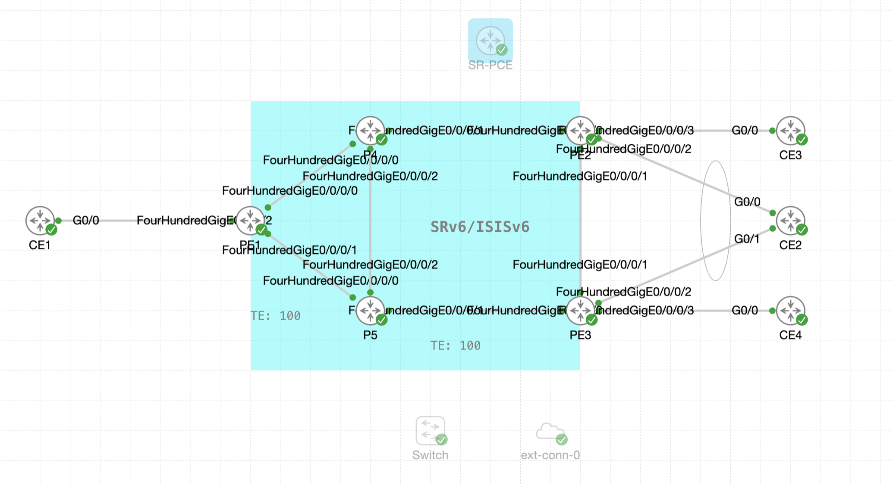
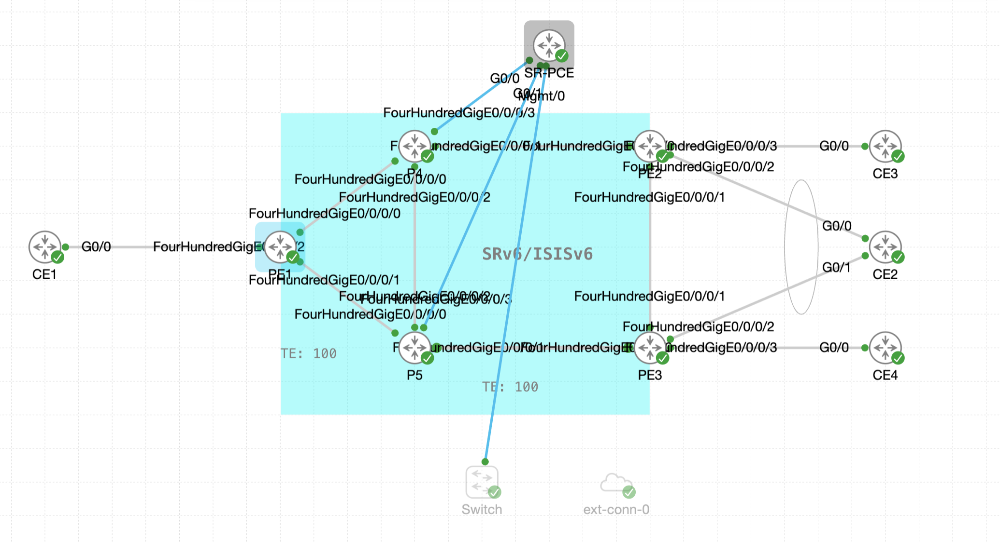

# 01. Demo Topology

!!! abstract "Goal"

    Understand the demo network: the routers, the SRv6 / IS-IS underlay, and how the SR-PCE feeds topology to CNC.

## 1.1 Routers

The blue part of the topology is the provider network. Five IOS XR routers run in CML, using the Cisco 8711-32FH emulator as PE and P routers.



```text
RP/0/RP0/CPU0:PE1#show version
Thu Oct 29 02:33:23.678 UTC
Cisco IOS XR Software, Version 25.4.2 LNT
Copyright (c) 2013-2026 by Cisco Systems, Inc.

Build Information:
 Built By     : cisco
 Built On     : Sun Mar 29 01:41:55 UTC 2026
 Build Host   : iox-lnx-005
 Workspace    : /auto/srcarchive12/prod/25.4.2/8000/ws/
 Version      : 25.4.2
 Label        : 25.4.2

cisco 8000 (VXR)
cisco 8711-32FH-M (VXR) processor with 16GB of memory
PE1 uptime is 5 days, 17 hours, 25 minutes
Cisco 8711 1RU 12.8T P100 System

RP/0/RP0/CPU0:PE1#show platform 
Thu Oct 29 02:33:26.667 UTC
Node              Type                     State                    Config state
--------------------------------------------------------------------------------
0/RP0/CPU0        8711-32FH-M(Active)      IOS XR RUN               NSHUT
0/FB0             UNKNOWN                  CARD FAILED              NSHUT
0/FT0             FAN-1RU-PI-V2            OPERATIONAL              NSHUT
0/FT1             FAN-1RU-PI-V2            OPERATIONAL              NSHUT
0/FT2             FAN-1RU-PI-V2            OPERATIONAL              NSHUT
0/FT3             FAN-1RU-PI-V2            OPERATIONAL              NSHUT
0/FT4             FAN-1RU-PI-V2            OPERATIONAL              NSHUT
0/FT5             FAN-1RU-PI-V2            OPERATIONAL              NSHUT
0/PM0             PSU2KW-ACPI              OPERATIONAL              NSHUT
0/PM1             PSU2KW-ACPI              OPERATIONAL              NSHUT
RP/0/RP0/CPU0:PE1#
```

<!-- SCREENSHOT: images/show-version.png | show version / show platform on PE1 -->

## 1.2 SRv6 and IS-IS

SRv6 and IS-IS for IPv6 are already enabled on all routers. Each router learns the other routers' loopbacks and locators through IS-IS.

```text
RP/0/RP0/CPU0:PE1#show isis adjacency
Thu Oct 29 02:36:44.379 UTC

IS-IS core Level-2 adjacencies:
System Id      Interface                SNPA           State Hold Changed  NSF IPv4 IPv6
                                                                               BFD  BFD 
P4             FH0/0/0/0                *PtoP*         Up    23   3d18h    Yes None None
P5             FH0/0/0/1                *PtoP*         Up    29   3d18h    Yes None None

Total adjacency count: 2
RP/0/RP0/CPU0:PE1#
RP/0/RP0/CPU0:PE1#show route ipv6 isis
Thu Oct 29 02:36:49.202 UTC

i L2 fcbb:bb00:2::/48 
      [115/21] via fe80::208:1fff:fe82:a800, 2d16h, FourHundredGigE0/0/0/0
i L2 fcbb:bb00:2::1/128 
      [115/20] via fe80::208:1fff:fe82:a800, 2d16h, FourHundredGigE0/0/0/0
i L2 fcbb:bb00:3::/48 
      [115/21] via fe80::206:d1ff:fec2:9800, 2d16h, FourHundredGigE0/0/0/1
i L2 fcbb:bb00:3::1/128 
      [115/20] via fe80::206:d1ff:fec2:9800, 2d16h, FourHundredGigE0/0/0/1
i L2 fcbb:bb00:4::/48 
      [115/11] via fe80::208:1fff:fe82:a800, 3d00h, FourHundredGigE0/0/0/0
i L2 fcbb:bb00:4::1/128 
      [115/10] via fe80::208:1fff:fe82:a800, 3d00h, FourHundredGigE0/0/0/0
i L2 fcbb:bb00:5::/48 
      [115/11] via fe80::206:d1ff:fec2:9800, 3d00h, FourHundredGigE0/0/0/1
i L2 fcbb:bb00:5::1/128 
      [115/10] via fe80::206:d1ff:fec2:9800, 3d00h, FourHundredGigE0/0/0/1
i L2 fcbb:bb00:6::1/128 
      [115/20] via fe80::208:1fff:fe82:a800, 3d00h, FourHundredGigE0/0/0/0
      [115/20] via fe80::206:d1ff:fec2:9800, 3d00h, FourHundredGigE0/0/0/1
i L2 fcbb:bb01:2::/48 
      [115/31] via fe80::206:d1ff:fec2:9800, 2d16h, FourHundredGigE0/0/0/1
i L2 fcbb:bb01:3::/48 
      [115/21] via fe80::206:d1ff:fec2:9800, 2d16h, FourHundredGigE0/0/0/1
i L2 fcbb:bb01:5::/48 
      [115/11] via fe80::206:d1ff:fec2:9800, 3d00h, FourHundredGigE0/0/0/1
RP/0/RP0/CPU0:PE1#  
```


A Flex-Algo 128 locator (`ALGO128`) is configured in addition to the default locator (`MAIN`).

```text
RP/0/RP0/CPU0:PE1#show segment-routing srv6 sid
Thu Oct 29 02:39:53.086 UTC

*** Locator: 'ALGO128' *** 

SID                         Behavior          Identification                    Owner               State  RW
--------------------------  ----------------  --------------------------------  ------------------  -----  --
fcbb:bb01:1::               uN (PSP/USD)      'default':1                       sidmgr              InUse  Y 
fcbb:bb01:1:e000::          uA (PSP/USD)      [FH0/0/0/0, Link-Local]:128       isis-core           InUse  Y 
fcbb:bb01:1:e001::          uA (PSP/USD)      [FH0/0/0/1, Link-Local]:128       isis-core           InUse  Y 

*** Locator: 'MAIN' *** 

fcbb:bb00:1::               uN (PSP/USD)      'default':1                       sidmgr              InUse  Y 
fcbb:bb00:1:e000::          uA (PSP/USD)      [FH0/0/0/0, Link-Local]:0         isis-core           InUse  Y 
fcbb:bb00:1:e001::          uA (PSP/USD)      [FH0/0/0/1, Link-Local]:0         isis-core           InUse  Y 
fcbb:bb00:1:e002::          uB6 (PSP/USD Insert.Red)  'srte_c_10_ep_fcbb:bb00:2::1' (10, fcbb:bb00:2::1)  xtc_srv6            InUse  Y 
fcbb:bb00:1:e004::          uDT4              'CustB'                           bgp-65000           InUse  Y 
fcbb:bb00:1:e005::          uDT4              'CustA'                           bgp-65000           InUse  Y 
fcbb:bb00:1:e007::          uDX2              101:100                           l2vpn_srv6          InUse  Y 
fcbb:bb00:1:e009::          uDT2U             103:0                             l2vpn_srv6          InUse  Y 
fcbb:bb00:1:e00a::          uDT2M             103:0                             l2vpn_srv6          InUse  Y 
fcbb:bb00:1:e00d::          uB6 (PSP/USD Insert.Red)  'srte_c_30_ep_fcbb:bb00:2::1' (30, fcbb:bb00:2::1)  xtc_srv6            InUse  Y 
fcbb:bb00:1:e00e::          uB6 (PSP/USD Insert.Red)  'srte_c_30_ep_fcbb:bb00:3::1' (30, fcbb:bb00:3::1)  xtc_srv6            InUse  Y 
RP/0/RP0/CPU0:PE1#
```

<!-- SCREENSHOT: images/srv6-sid.png | show segment-routing srv6 sid with MAIN and ALGO128 locators -->

Core links use link-local addresses only, so no global addresses are configured on them.

```text
RP/0/RP0/CPU0:PE1#show running-config interface FourHundredGigE 0/0/0/0
Thu Oct 29 02:40:32.881 UTC
interface FourHundredGigE0/0/0/0
 ipv6 enable
!

RP/0/RP0/CPU0:PE1#show ipv6 interface brief
Thu Oct 29 02:40:38.078 UTC
Loopback0              [Up/Up]
    fe80::c44e:deff:fe0f:1fa8                     
    fcbb:bb00:1::1                                
FourHundredGigE0/0/0/0 [Up/Up]
    fe80::28a:19ff:fe13:dc00                      
FourHundredGigE0/0/0/1 [Up/Up]
    fe80::28a:19ff:fe13:dc08                      
FourHundredGigE0/0/0/2 [Up/Up]
    unassigned                                    
FourHundredGigE0/0/0/2.200 [Up/Up]
    unassigned                                    
FourHundredGigE0/0/0/2.500 [Up/Up]
    unassigned                                    
FourHundredGigE0/0/0/3 [Shutdown/Down]
    unassigned                                  
MgmtEth0/RP0/CPU0/0    [Up/Up]
    unassigned                                    
RP/0/RP0/CPU0:PE1#
```

<!-- SCREENSHOT: images/link-local.png | Core interface configuration and show ipv6 interface brief -->

## 1.3 SR-PCE



An XRv 9000 runs as the SR-PCE and is connected to P4 and P5.

```text
RP/0/RP0/CPU0:SR-PCE#show version
Thu Oct 29 02:42:40.085 UTC
Cisco IOS XR Software, Version 26.1.1
Copyright (c) 2013-2026 by Cisco Systems, Inc.

Build Information:
 Built By     : swtools
 Built On     : Wed Feb 25 21:16:23 PST 2026
 Built Host   : iox-ucs-1001
 Workspace    : /auto/srcarchive12/prod/26.1.1/xrv9k/ws
 Version      : 26.1.1
 Location     : /opt/cisco/XR/packages/
 Label        : 26.1.1

cisco IOS-XRv 9000 () processor
System uptime is 3 days 20 hours 45 minutes

RP/0/RP0/CPU0:SR-PCE#
```

The SR-PCE collects topology information from the network over BGP-LS sessions with the routers.

```text
RP/0/RP0/CPU0:SR-PCE#show bgp link-state link-state neighbors brief
Thu Oct 29 02:42:53.282 UTC

Neighbor         Spk    AS  Description                         Up/Down  NBRState
fcbb:bb00:1::1    0 65000                                         3d16h Established 
fcbb:bb00:2::1    0 65000                                         2d16h Established 
fcbb:bb00:3::1    0 65000                                         2d16h Established 
fcbb:bb00:4::1    0 65000                                         3d16h Established 
fcbb:bb00:5::1    0 65000                                         3d16h Established 
RP/0/RP0/CPU0:SR-PCE#
```

<!-- SCREENSHOT: images/bgp-ls.png | BGP-LS neighbors on SR-PCE -->

The SR-PCE forwards this information to CNC through the gRPC API.

```text
RP/0/RP0/CPU0:SR-PCE#show running-config grpc
Thu Oct 29 02:43:04.018 UTC
grpc
 port 57400
 no-tls
 address-family ipv4
 service-layer
 !
!
```

The SR-PCE also has PCEP sessions with the PEs, which act as head-ends for SR policies.
This lets the head-ends delegate path computation to the PCE.

```text
RP/0/RP0/CPU0:SR-PCE#show pce ipv6 peer
Thu Oct 29 02:43:20.775 UTC

PCE's peer database: 
--------------------
Peer address: fcbb:bb00:1::1
  State: Up
  Capabilities: Stateful, Segment-Routing, Update, Instantiation, SRv6, SR-P2MP

Peer address: fcbb:bb00:2::1
  State: Up
  Capabilities: Stateful, Segment-Routing, Update, Instantiation, SRv6, SR-P2MP

Peer address: fcbb:bb00:3::1
  State: Up
  Capabilities: Stateful, Segment-Routing, Update, Instantiation, SRv6, SR-P2MP

RP/0/RP0/CPU0:SR-PCE#
```

<!-- SCREENSHOT: images/pcep-peer.png | show pce ipv6 peer on SR-PCE -->

## Next step

Go to [02. Dashboard and Crosswork Manager](../02-dashboard/index.md).
