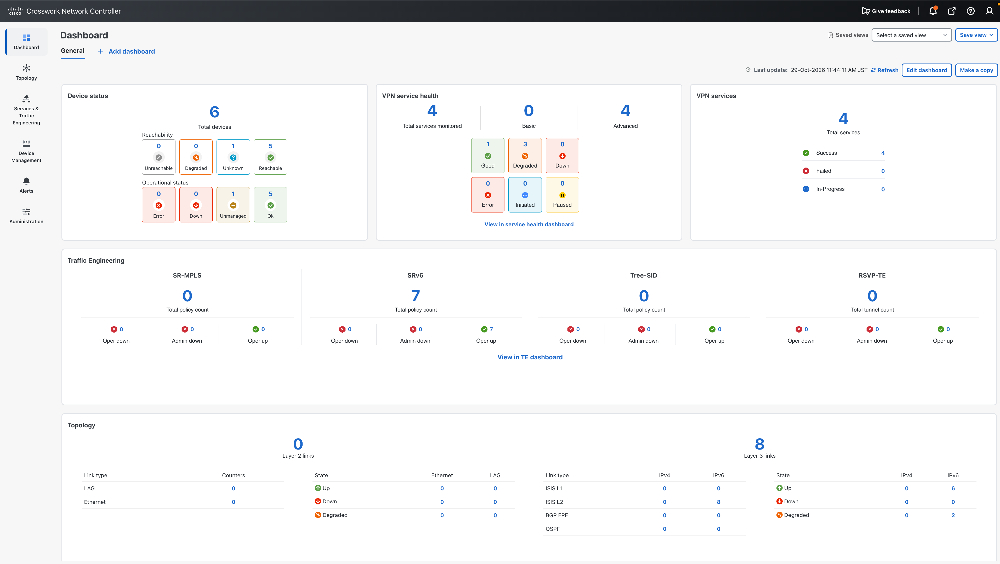
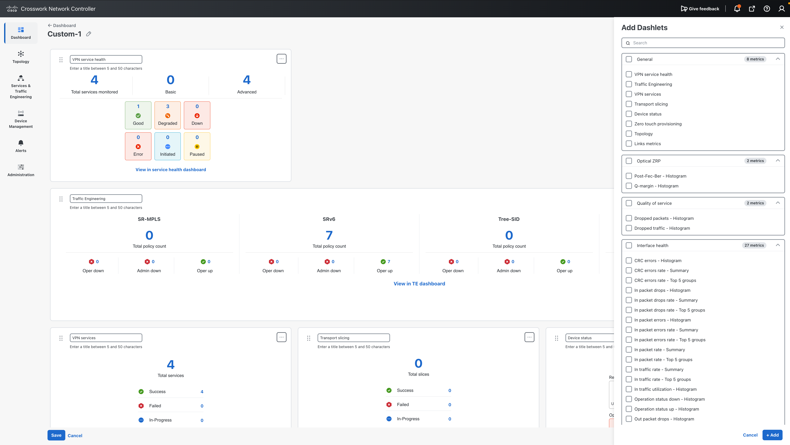
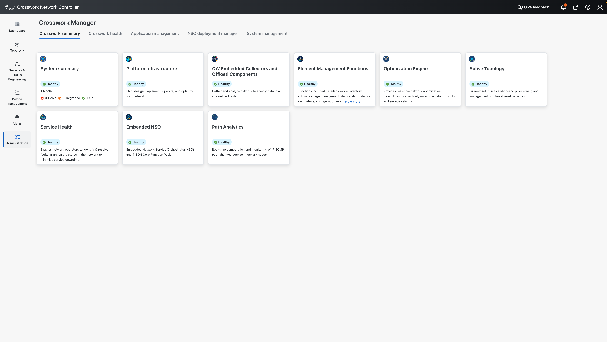
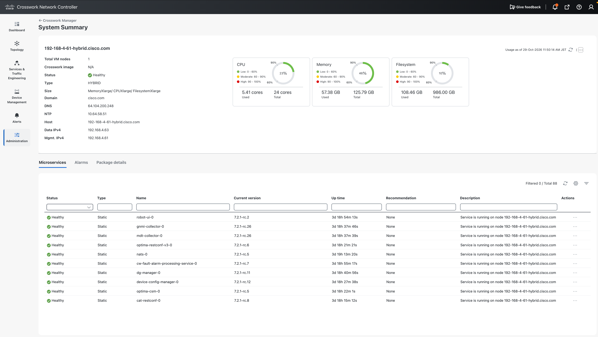
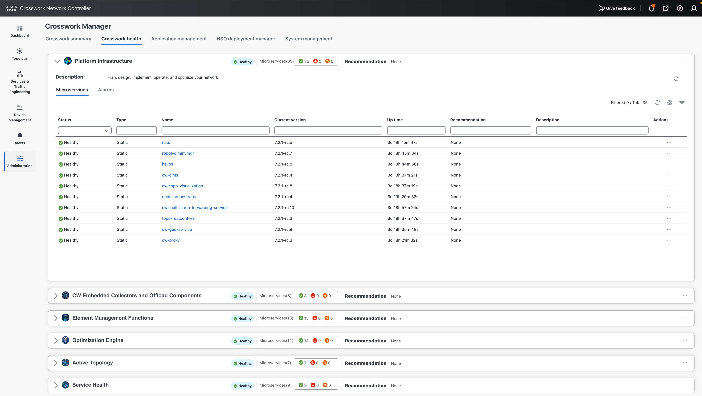
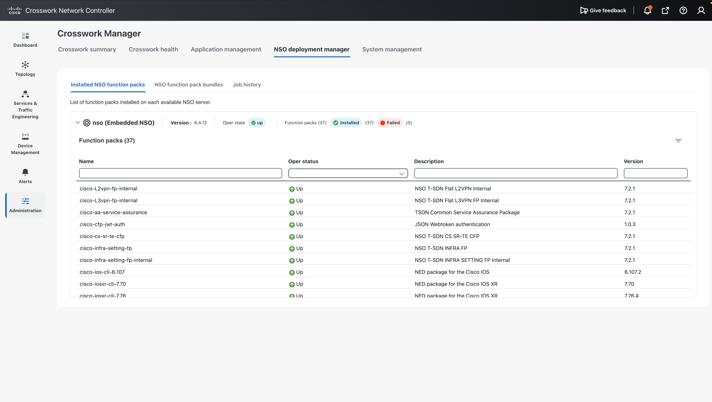
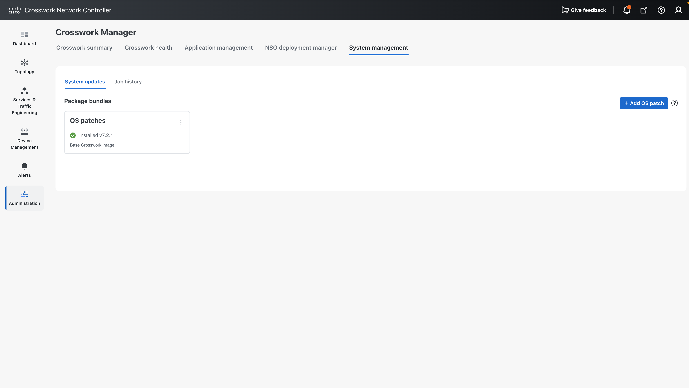

# 02. Dashboard and Crosswork Manager

!!! abstract "Goal"

    See the overall network and service status on the CNC dashboard, and check the health of CNC itself.

## 2.1 CNC dashboard

This is the first screen after logging in to CNC. One dashboard shows:

- Status of the devices managed by CNC
- Number and status of VPN services
- Status of Traffic Engineering policies
- Topology status

You can also add and edit dashboards.

<!-- SCREENSHOT: images/dashboard.png | CNC dashboard after login -->

## 2.2 Crosswork Manager

To check the status of CNC itself, go to **Administration > Crosswork Manager**.

- **Application status** shows the installed applications.

- **System summary** shows the CPU/Memory/Filesystem Utilization.

- **Crosswork Health** shows the status of the microservices of each application.

<!-- SCREENSHOT: images/crosswork-health.png | Crosswork Health with microservice status -->

## 2.3 NSO and Function Packs

**NSO Deployment Manager** shows the NSO connected to CNC.
**Installed Function Pack** shows which devices and services NSO supports.
In this demo, the Function Packs for L2VPN, L3VPN and SR-TE are installed, together with the IOS and IOS XR NEDs.

## 2.4 CNC version

**System Management** shows the running CNC version. This demo uses CNC 7.2.1.

## Next step

Go to [03. Topology and Service Visualization](../03-visualization/index.md).
