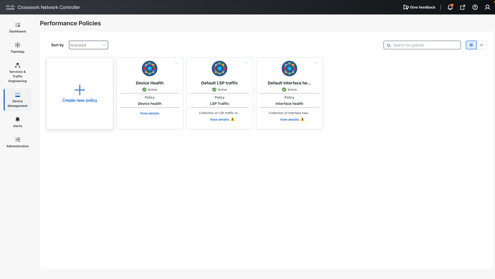
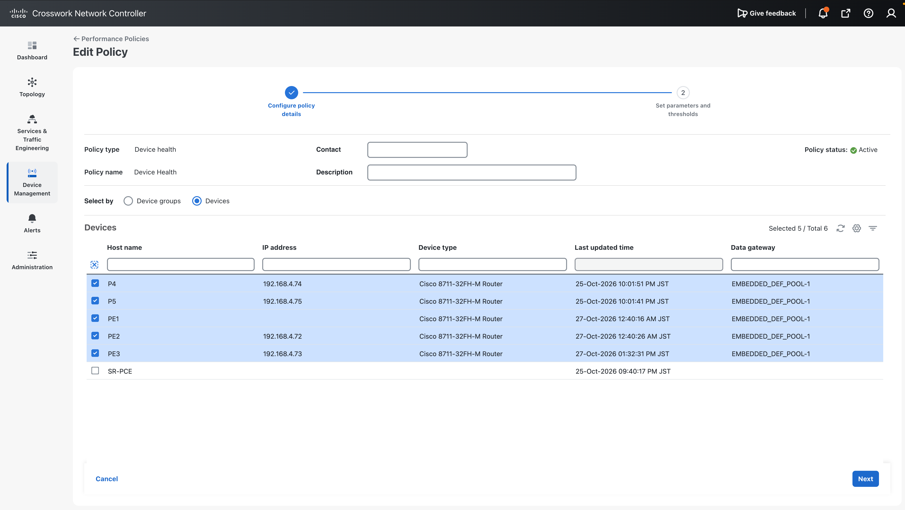
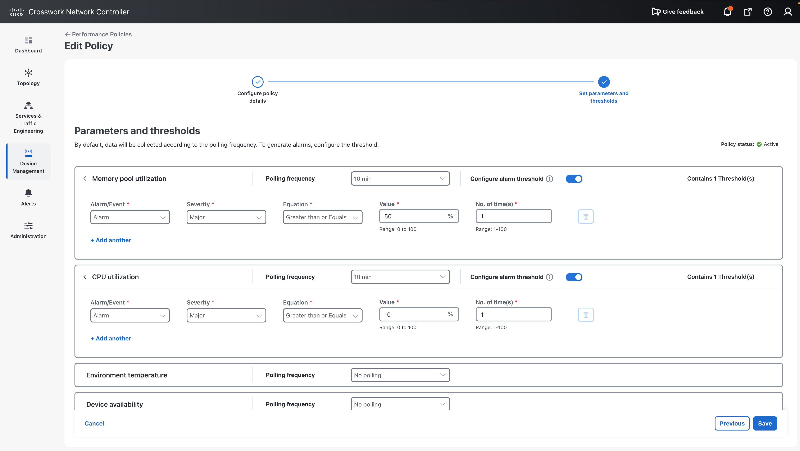
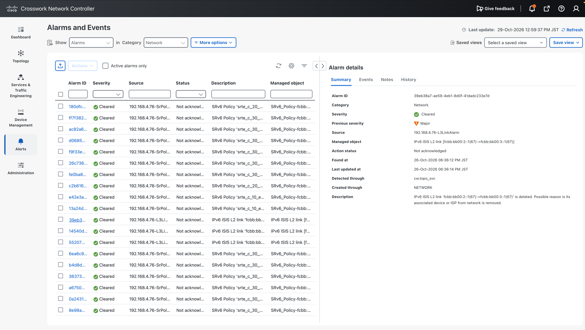
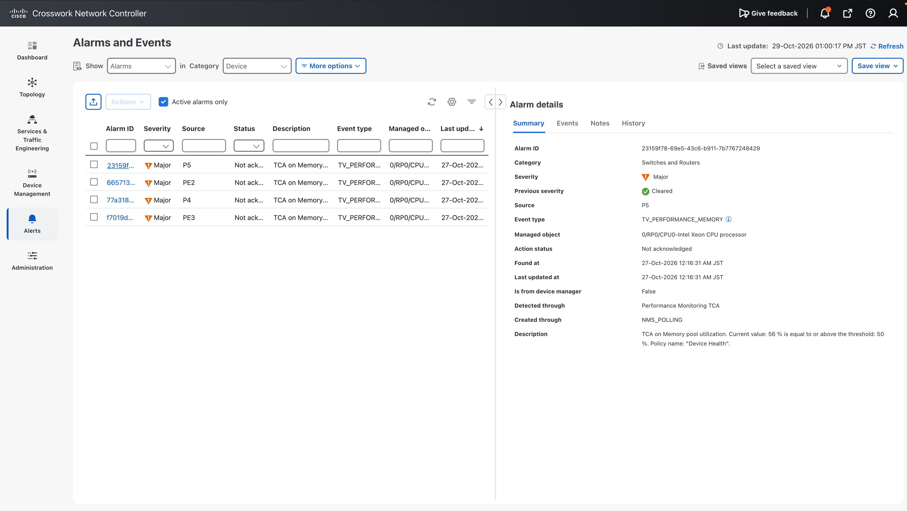

# 04. Performance Monitoring and Alarms

!!! abstract "Goal"

    Understand how CNC collects performance data with policies, and how alarms and events are shown.

## 4.1 Performance policies

Go to **Device Management > Performance Policies** to list the enabled policies.

- **LSP Traffic** and **Interface Health** are enabled by default. The link utilization shown in
  [03. Topology and Service Visualization](../03-visualization/index.md) is collected by these policies.
- **Device Health** is enabled in this demo. It collects the CPU and memory utilization shown in the device history.

For each policy you can set the target devices, the collection interval, and the alarm thresholds.

## 4.2 Alarms and events

Select **Alarms and Events**. Alarms are grouped by category.

**Network Alarms** shows the history of up/down events for links and SR policies.

**Device Alarms** shows alerts raised because the Device Health thresholds were exceeded.
Select an alarm to see the **Description**. In this example, memory utilization is 57% against a 50% threshold.

## Next step

Go to [05. SR Policy Provisioning](../05-sr-policy/index.md).
