# 05. SR Policy Provisioning

!!! abstract "Goal"
    Create an SRv6-TE policy from CNC, with the path computed by the SR-PCE using the TE metric.


!!! note
    This demo uses the standard CNC Function Pack service models. If you use customized NSO service models,
    the provisioning screens and input parameters may be different.

## 5.1 Scenario

On the topology, the TE metric is set to 100 on the PE1-P5 and P5-PE3 links. The default TE metric is 10.

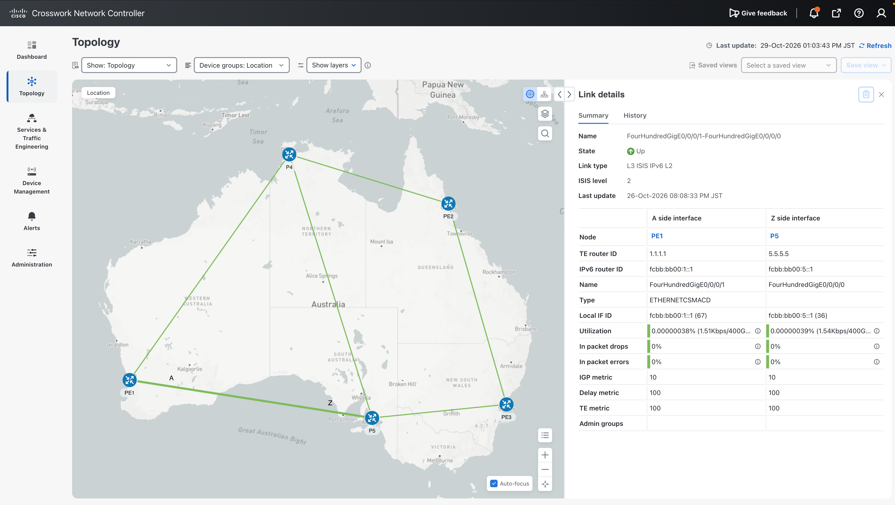
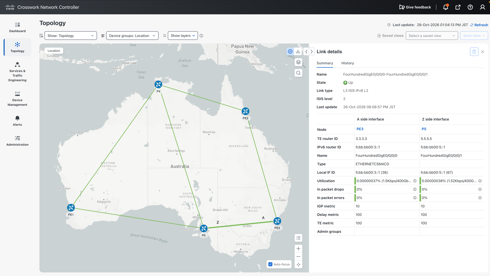

We create a dynamic SRv6 policy with color 20 from PE1 (head-end) to PE3 (end-point), optimized on the TE metric.
Traffic from PE1 to PE3 is then expected to avoid the lower path through P5 and take the upper path through P4.


## 5.2 Create the policy

1. Go to **Services & Traffic Engineering > Provisioning** and select **SR-TE Policy**.

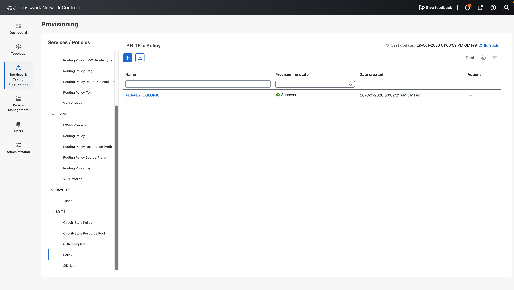
2. Click **+** and enter `PE1-PE3_COLOR20` as the name. Click **Continue** to set the head-end, tail-end, color and path.
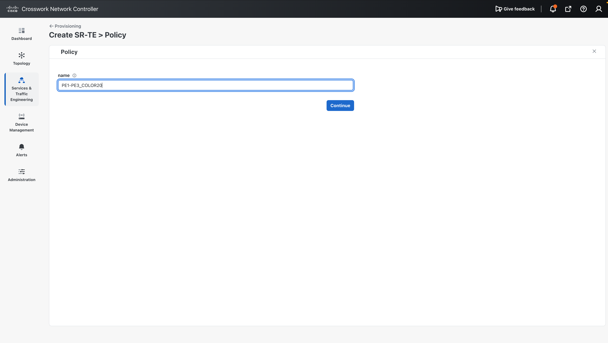
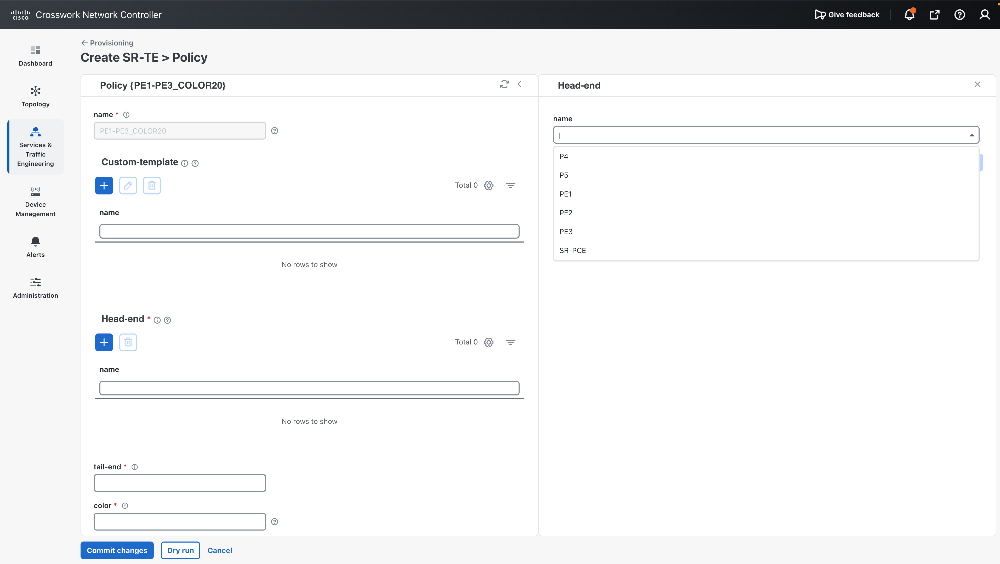
3. To save time, cancel and use **Import** to load a JSON file instead.
   A sample JSON can be downloaded from the same dialog.
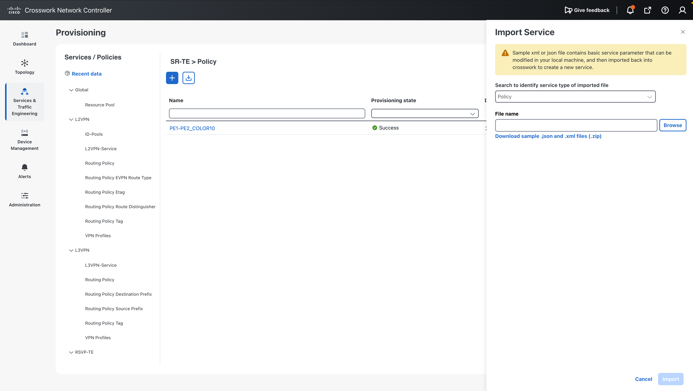

Payload: [pcc-init_policy_color20.json](../payloads/pcc-init_policy_color20.json)

```json
{
  "cisco-sr-te-cfp:sr-te": {
    "cisco-sr-te-cfp-sr-policies:policies": {
      "policy": [
        {
          "name": "PE1-PE3_COLOR20",
          "head-end": [{ "name": "PE1" }],
          "srv6": {
            "locator": {
              "locator-name": "MAIN",
              "behavior": "ub6-insert-reduced",
              "binding-sid-type": "srv6-dynamic"
            }
          },
          "tail-end": "fcbb:bb00:3::1",
          "color": 20,
          "path": [
            {
              "preference": 100,
              "dynamic": { "pce": {}, "metric-type": "te" }
            }
          ]
        }
      ]
    }
  }
}
```


## 5.3 Check the parameters


| Parameter    | Value            | Notes                                                     |
| ------------ | ---------------- | --------------------------------------------------------- |
| Head-end     | PE1              |                                                           |
| Tail-end     | `fcbb:bb00:3::1` | PE3 loopback                                              |
| Color        | 20               |                                                           |
| Path         | Dynamic, PCE     | Path computation is delegated to the SR-PCE               |
| Metric type  | TE               | Affinity, disjoint path and metric margin can also be set |
| SRv6 locator | MAIN             | SRv6 is used for the underlay                             |


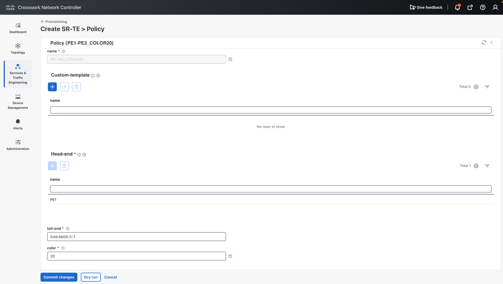
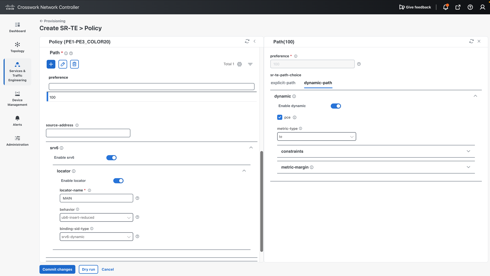

## 5.4 Dry run and commit

Click **Dry Run** to see the configuration diff that will be sent to the device. 

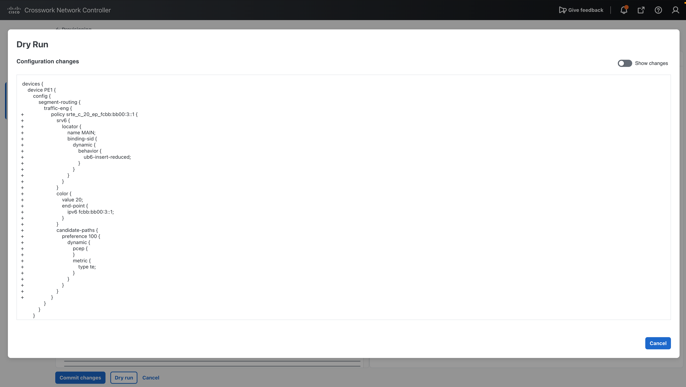

You can switch the display format.
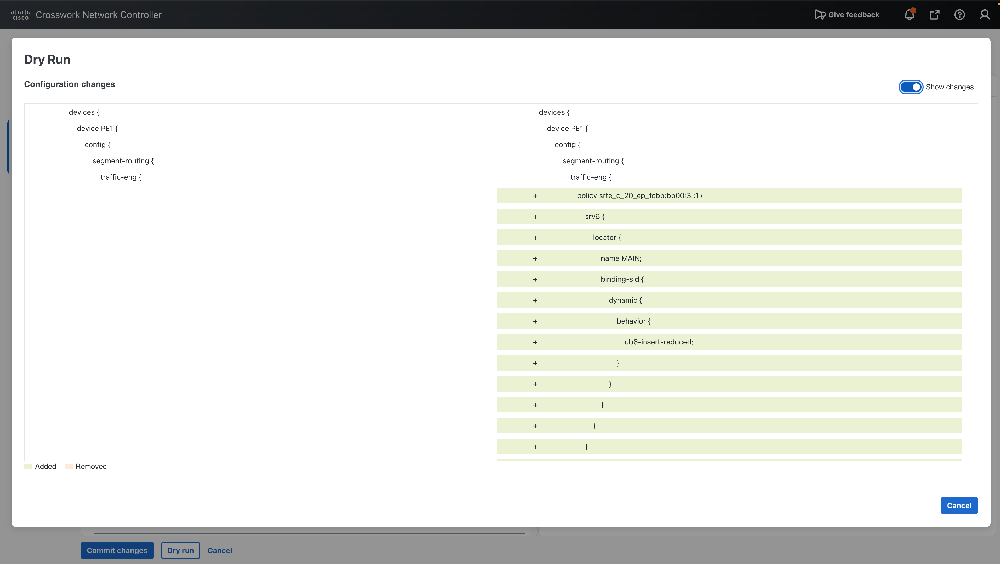

If there are no problems, click **Commit**.

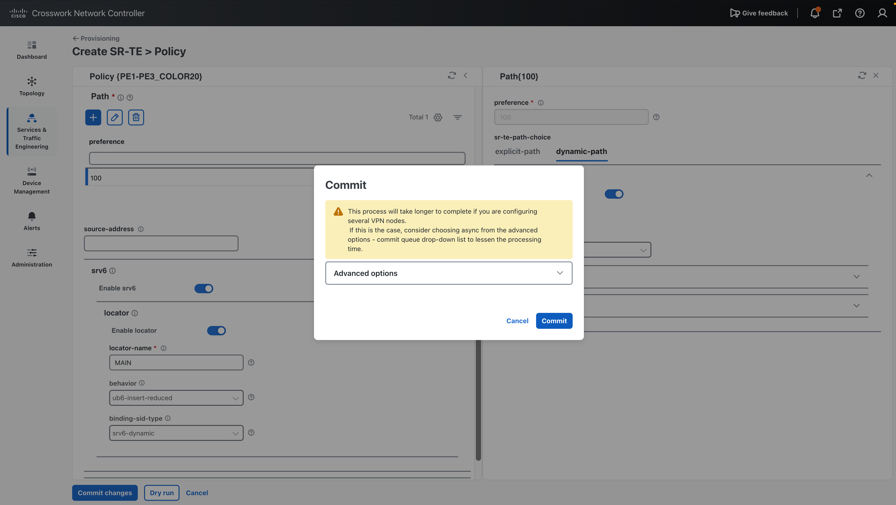
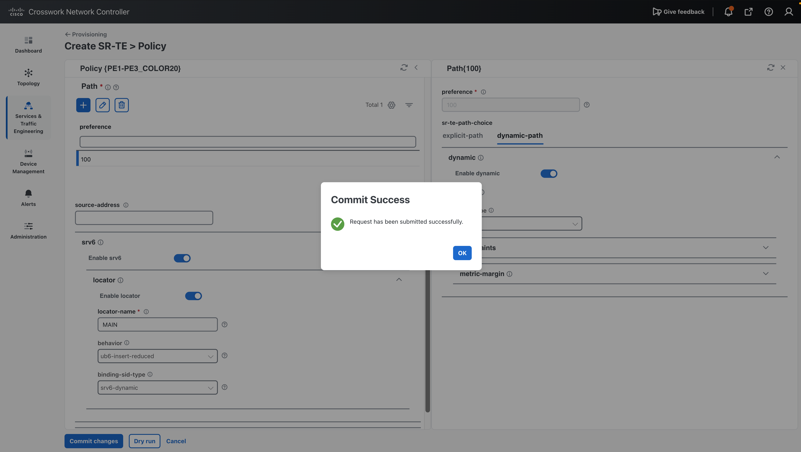

## 5.5 Verify

When the configuration is complete, check the SR policy name.
It avoids the links with the higher TE metric.

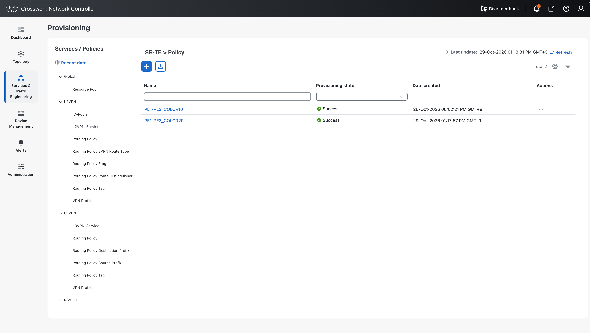
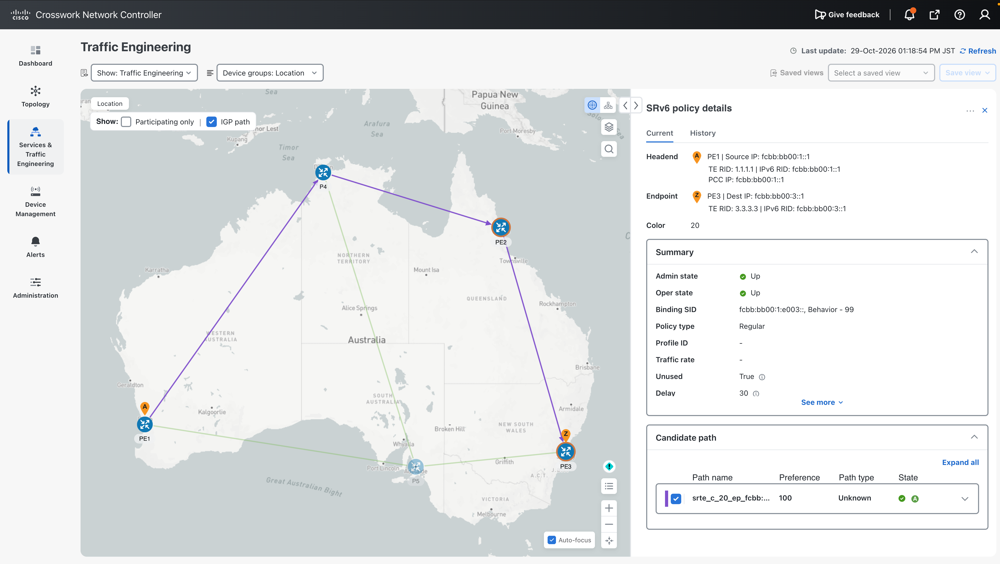
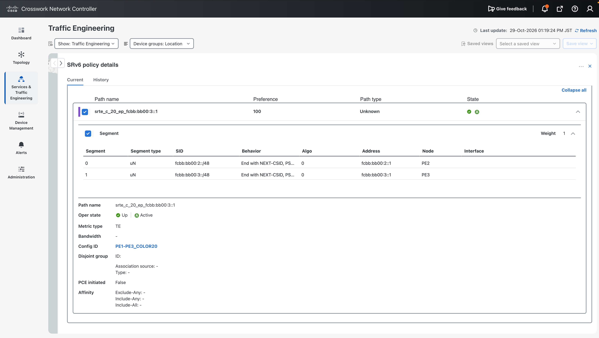

On PE1:

```text
RP/0/RP0/CPU0:PE1#show segment-routing traffic-eng policy color 20
Thu Oct 29 04:21:14.913 UTC

SR-TE policy database
---------------------

Color: 20, End-point: fcbb:bb00:3::1
  Name: srte_c_20_ep_fcbb:bb00:3::1
  Status:
    Admin: up  Operational: up for 00:03:09 (since Oct 29 04:18:05.672)
  Candidate-paths:
    Preference: 100 (configuration) (active)
      Name: srte_c_20_ep_fcbb:bb00:3::1
      Requested BSID: dynamic
      PCC info:
        Symbolic name: cfg_srte_c_20_ep_fcbb:bb00:3::1_discr_100
        PLSP-ID: 13
      Constraints:
        Protection Type: protected-preferred
        Maximum SID Depth: 7 
      Dynamic (pce fcbb:bb00:6::1) (valid)
        Metric Type: TE (IANA PCEP/IGP: 2/2), Path Accumulated Metric: 30 
          SID[0]: fcbb:bb00:2::/48 Behavior: uN (PSP/USD) (48)
                  Format: f3216
                  LBL:32 LNL:16 FL:0 AL:80
                  Address: fcbb:bb00:2::1
          SID[1]: fcbb:bb00:3::/48 Behavior: uN (PSP/USD) (48)
                  Format: f3216
                  LBL:32 LNL:16 FL:0 AL:80
                  Address: fcbb:bb00:3::1
      SRv6 Information: 
        Locator: MAIN
        Binding SID requested: Dynamic
        Binding SID behavior: uB6 (PSP/USD Insert.Red)
        Explicit binding SID enforced: No
        Install Final Node SID: No
  Attributes:
    Binding SID: fcbb:bb00:1:e003::
    Forward Class: Not Configured
    Steering labeled-services disabled: no
    Steering BGP disabled: no
    IPv6 caps enable: yes
    Invalidation drop enabled: no
    Max Install Standby Candidate Paths: 0
    Path Type: SRV6

RP/0/RP0/CPU0:PE1#
```


## Next step

Go to [06. L3VPN Provisioning](../06-l3vpn/index.md).