# 06. L3VPN Provisioning

!!! abstract "Goal"

    Create an SRv6 L3VPN from CNC and steer its traffic onto the color 20 policy with Automated Steering.

## 6.1 Preparation: route policy tag and routing policy

To steer the VPN traffic onto the color 20 policy from [05. SR Policy Provisioning](../05-sr-policy/index.md),
the VPN routes must carry color 20. These objects are created in advance:

| Object              | Name       | Payload                                                                                         |
| ------------------- | ---------- | ----------------------------------------------------------------------------------------------- |
| Route policy tag    | `COLOR_20` | [l3vpn-route-policy-tag_Color20.json](../payloads/preconfiguration/l3vpn-route-policy-tag_Color20.json) |
| Routing policy      | `POLICY2`  | [l3vpn-route-policy_Policy2.json](../payloads/preconfiguration/l3vpn-route-policy_Policy2.json)         |

`POLICY2` sets the color 20 extended community on the VPN routes advertised to the remote PEs over MP-BGP.

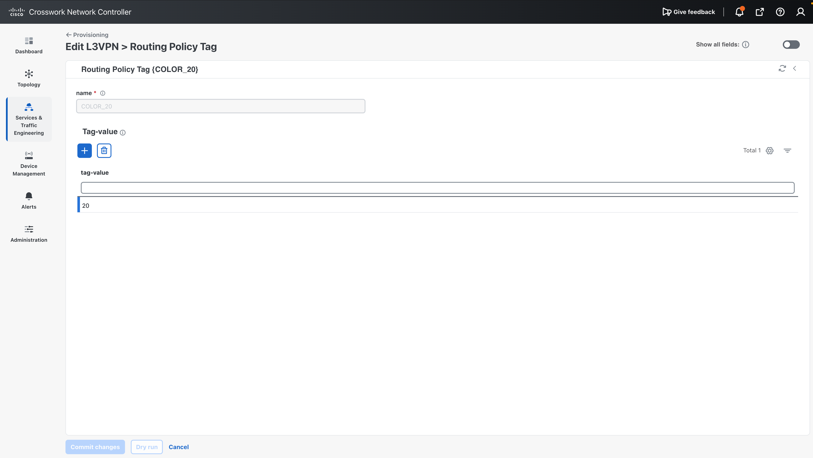
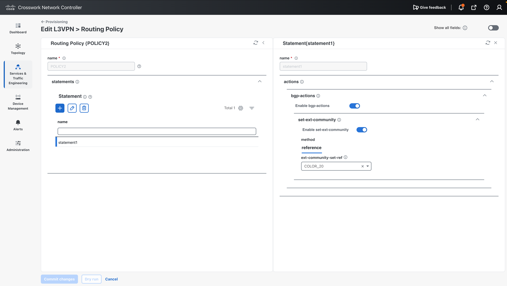

## 6.2 Create the L3VPN service

1. Go to **Services & Traffic Engineering > Provisioning** and select **L3VPN-Service**.
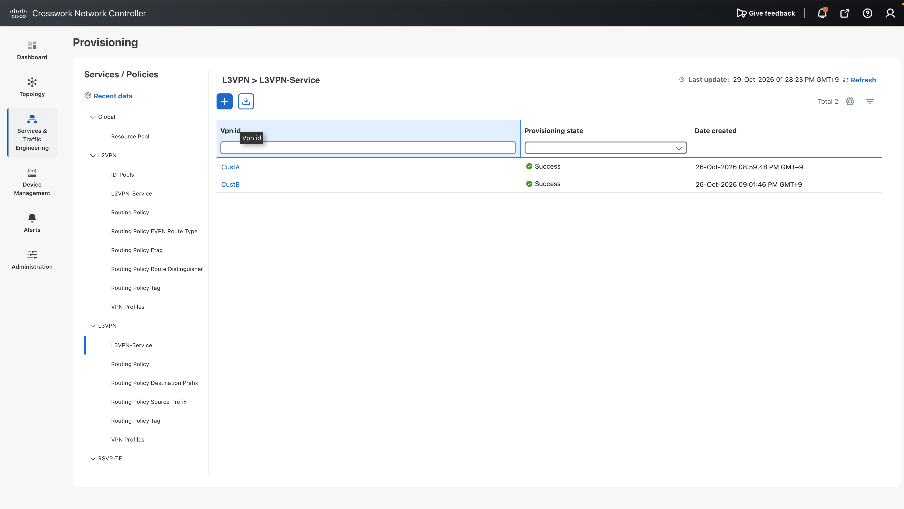
2. Add CustomerC's VPN: enter `CustC` as the name and add the VPN nodes.
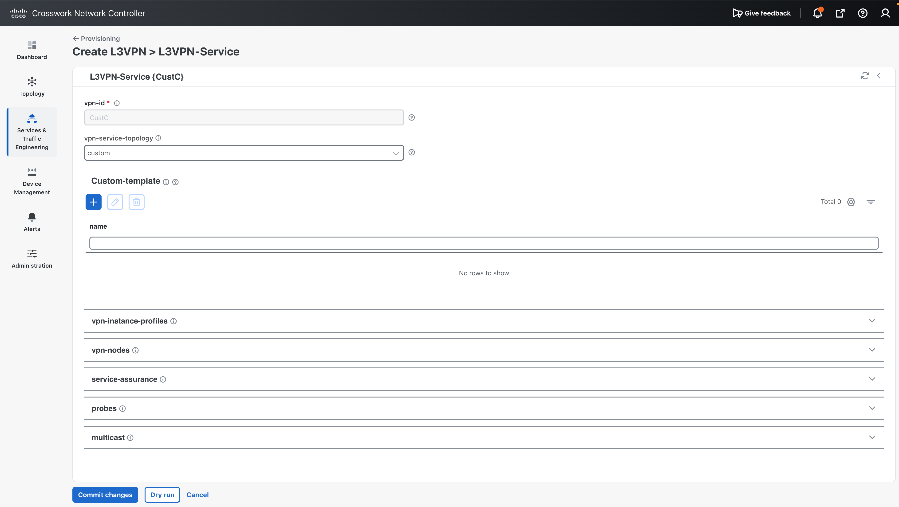
3. To save time, load the JSON file.
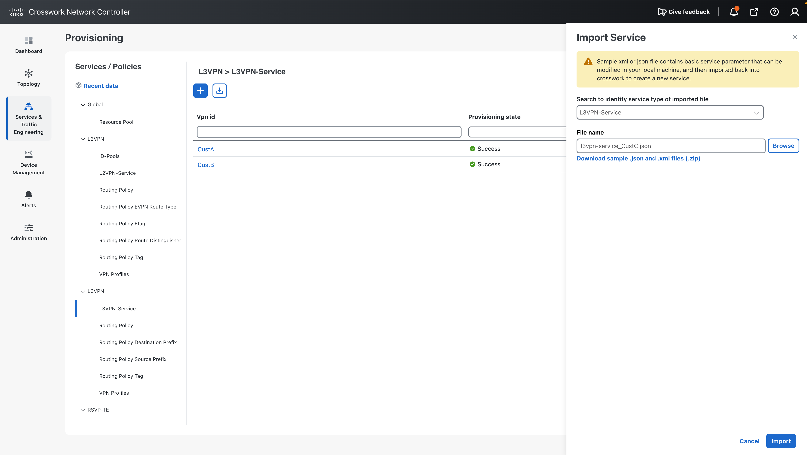

Payload: [l3vpn-service_CustC.json](../payloads/l3vpn-service_CustC.json)

<!-- SCREENSHOT: images/l3vpn-import.png | L3VPN-Service import dialog -->

## 6.3 Check the parameters

| Parameter                        | Value                          | Notes                                              |
| -------------------------------- | ------------------------------ | -------------------------------------------------- |
| `vpn-id`                         | `CustC`                        | Used as the VRF name                               |
| `vpn-service-topology`           | `custom`                       | RTs are taken only from the profile                |
| VPN instance profile `default`   | RD `0:102:102`, RT `0:102:102` both, export policy `POLICY2` | Common to all PEs in the VPN |
| SRv6                             | IPv4, locator `MAIN`           | uDT4 SID is allocated from locator MAIN            |
| VPN nodes                        | PE1, PE2, PE3                  | Each uses profile `default`                        |
| Access interface                 | dot1q 102, `172.16.N.1/24`, direct routing | Connected routes are redistributed into BGP |
| Service assurance                | `Gold_L3VPN_ConfigProfile`     | VPN monitoring with Service Health                 |

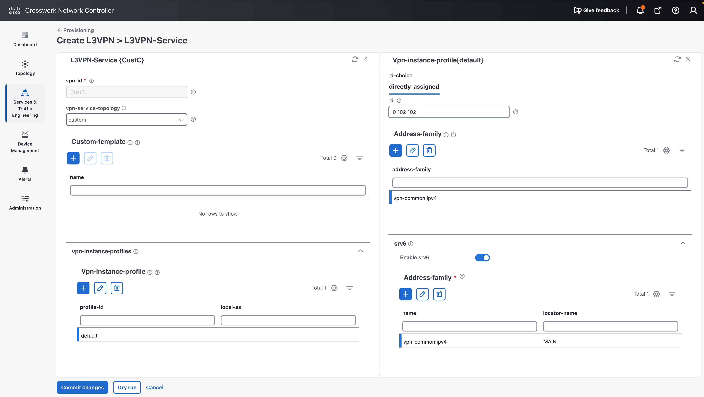
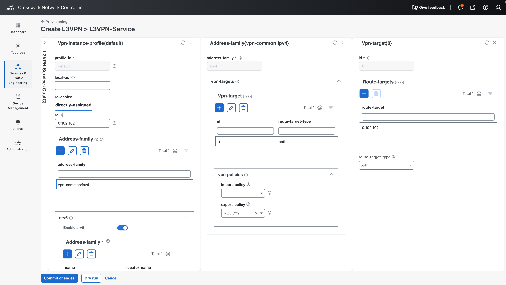
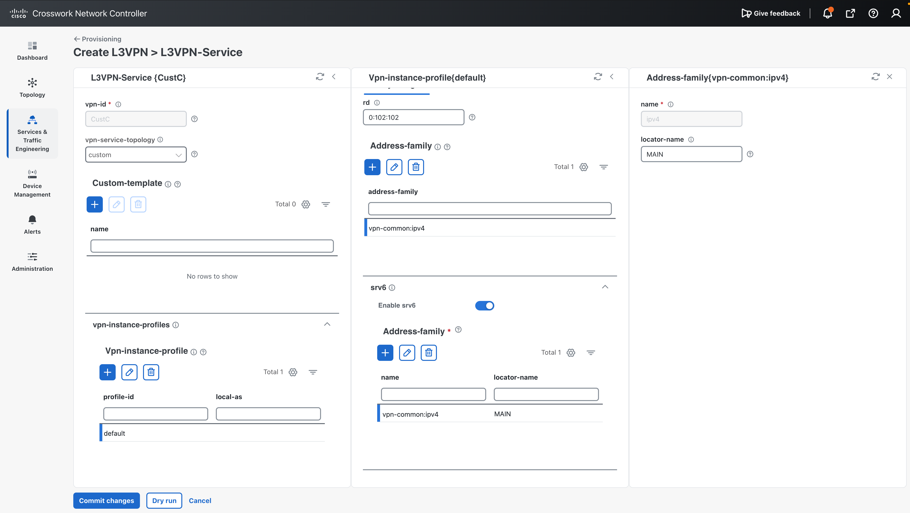
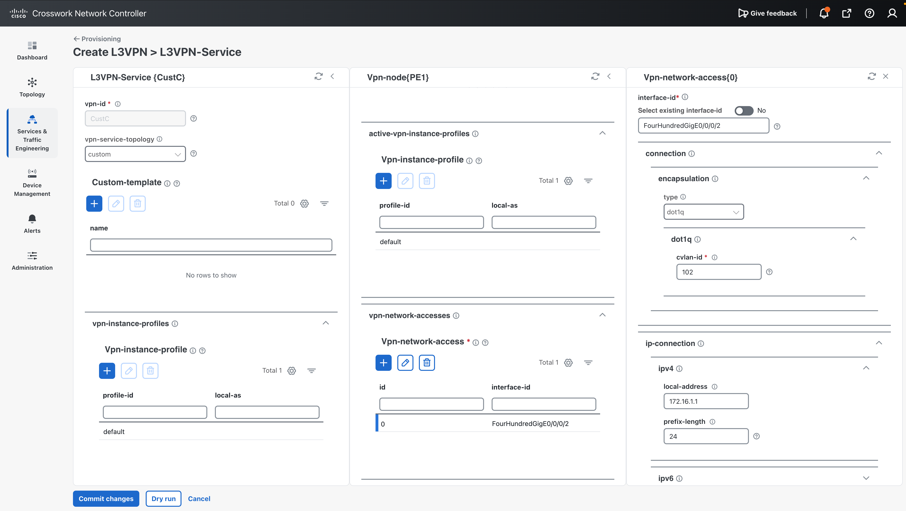
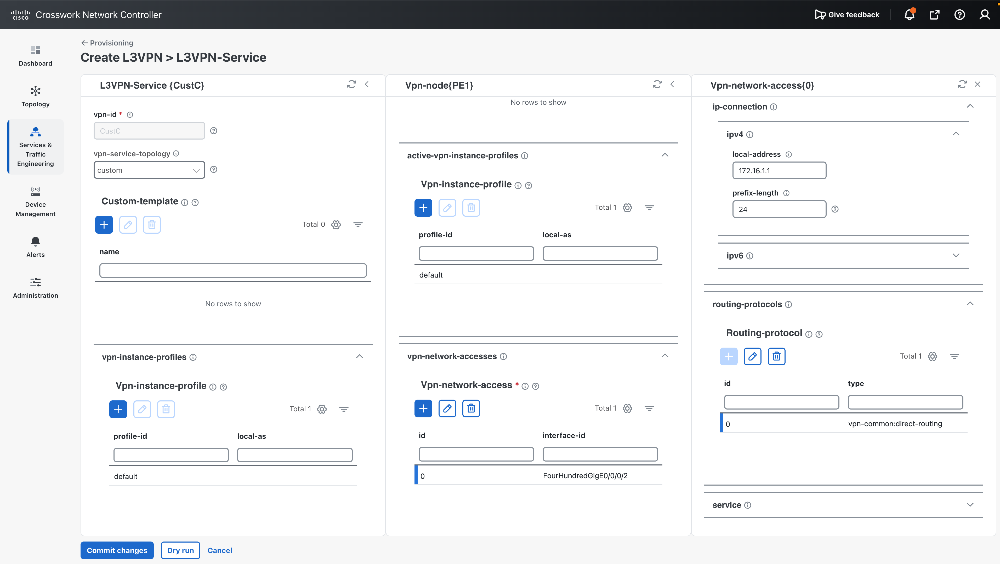

!!! tip "Things to watch in the payload"

    - With `vpn-service-topology` set to `any-to-any`, CNC also allocates a hub RT from the RT pool and adds it as import/export.
      Use `custom` if you want only the RTs in the profile.
    - If a VPN node defines its own `address-family` under `active-vpn-instance-profiles`, that definition replaces the
      service-level one, including `vpn-policies`. Put `export-policy` there as well, or remove the node-level `address-family`.

## 6.4 Dry run and commit

Run **Dry Run** to check the configuration diff. 
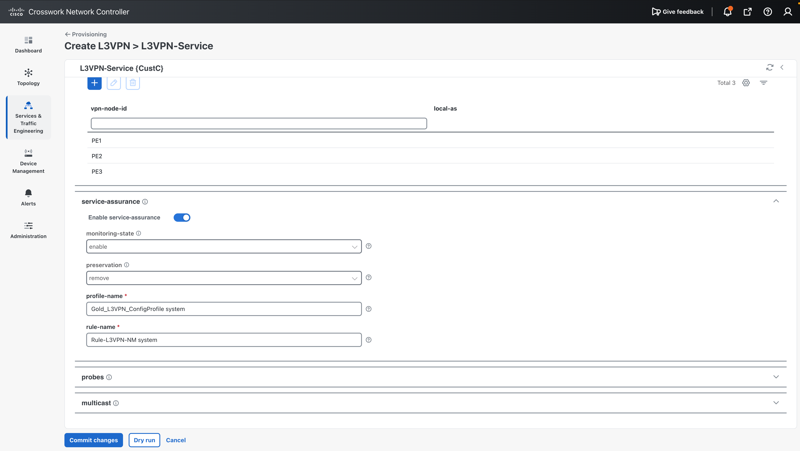
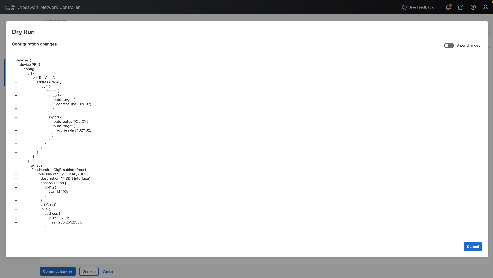

If there are no problems, click **Commit**.
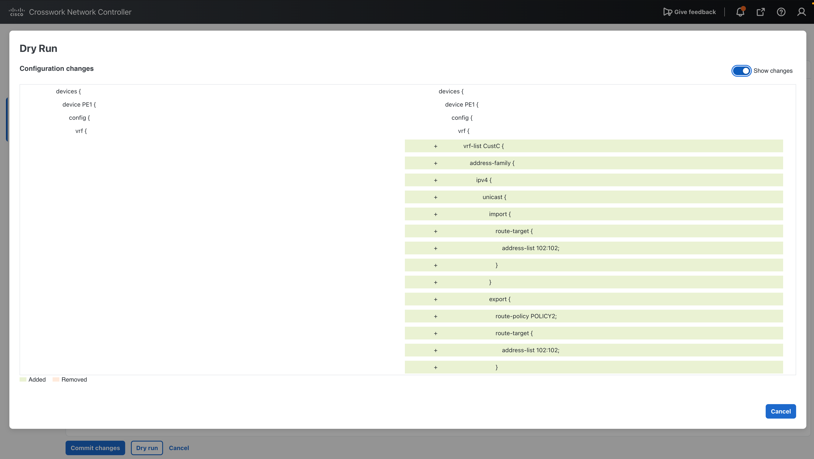

The generated configuration on each PE looks like this (excerpt):

```text
extcommunity-set opaque COLOR_20
  20
end-set
!
route-policy POLICY2
  set extcommunity color COLOR_20
end-policy
!
vrf CustC
 address-family ipv4 unicast
  import route-target
   102:102
  !
  export route-policy POLICY2
  export route-target
   102:102
  !
 !
!
router bgp 65000
 vrf CustC
  rd 102:102
  address-family ipv4 unicast
   redistribute connected
   segment-routing srv6
    locator MAIN
    alloc mode per-vrf
```

## 6.5 Verify

When the configuration is complete, the service is visualized in CNC.
**Transport** shows that CustC traffic from PE1 to PE3 uses the color 20 policy.

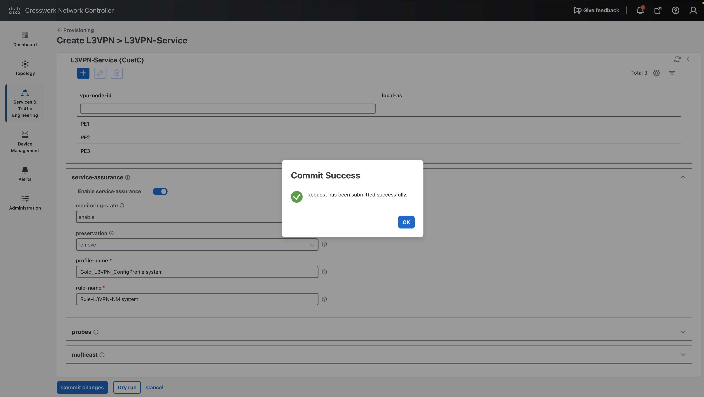
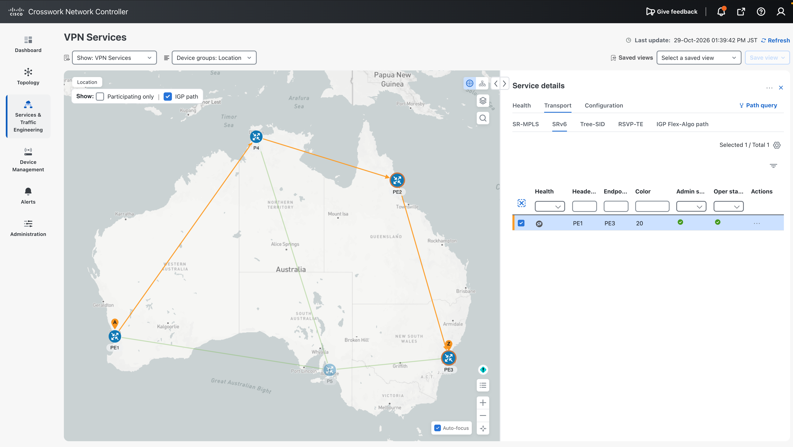

On PE1:

```text
RP/0/RP0/CPU0:PE1#show bgp vpnv4 unicast vrf CustC
Thu Oct 29 04:39:56.280 UTC
BGP router identifier 1.1.1.1, local AS number 65000
BGP generic scan interval 60 secs
Non-stop routing is enabled
BGP table state: Active
Table ID: 0x0
BGP main routing table version 104
BGP NSR Initial initsync version 4 (Reached)
BGP NSR/ISSU Sync-Group versions 0/0
BGP scan interval 60 secs

Status codes: s suppressed, d damped, h history, * valid, > best
              i - internal, r RIB-failure, S stale, N Nexthop-discard
Origin codes: i - IGP, e - EGP, ? - incomplete
   Network            Next Hop            Metric LocPrf Weight Path
Route Distinguisher: 102:102 (default for vrf CustC)
Route Distinguisher Version: 104
*> 172.16.1.0/24      0.0.0.0                  0         32768 ?
*>i172.16.2.0/24      fcbb:bb00:2::1           0    100      0 ?
*>i172.16.3.0/24      fcbb:bb00:3::1 C:20
                                               0    100      0 ?

Processed 3 prefixes, 3 paths
RP/0/RP0/CPU0:PE1#
RP/0/RP0/CPU0:PE1#show segment-routing srv6 sid
Thu Oct 29 04:40:05.777 UTC

*** Locator: 'ALGO128' *** 

SID                         Behavior          Identification                    Owner               State  RW
--------------------------  ----------------  --------------------------------  ------------------  -----  --
fcbb:bb01:1::               uN (PSP/USD)      'default':1                       sidmgr              InUse  Y 
fcbb:bb01:1:e000::          uA (PSP/USD)      [FH0/0/0/0, Link-Local]:128       isis-core           InUse  Y 
fcbb:bb01:1:e001::          uA (PSP/USD)      [FH0/0/0/1, Link-Local]:128       isis-core           InUse  Y 

*** Locator: 'MAIN' *** 

fcbb:bb00:1::               uN (PSP/USD)      'default':1                       sidmgr              InUse  Y 
fcbb:bb00:1:e000::          uA (PSP/USD)      [FH0/0/0/0, Link-Local]:0         isis-core           InUse  Y 
fcbb:bb00:1:e001::          uA (PSP/USD)      [FH0/0/0/1, Link-Local]:0         isis-core           InUse  Y 
fcbb:bb00:1:e002::          uB6 (PSP/USD Insert.Red)  'srte_c_10_ep_fcbb:bb00:2::1' (10, fcbb:bb00:2::1)  xtc_srv6            InUse  Y 
fcbb:bb00:1:e003::          uB6 (PSP/USD Insert.Red)  'srte_c_20_ep_fcbb:bb00:3::1' (20, fcbb:bb00:3::1)  xtc_srv6            InUse  Y 
fcbb:bb00:1:e004::          uDT4              'CustB'                           bgp-65000           InUse  Y 
fcbb:bb00:1:e005::          uDT4              'CustA'                           bgp-65000           InUse  Y 
fcbb:bb00:1:e006::          uDT4              'CustC'                           bgp-65000           InUse  Y 
fcbb:bb00:1:e007::          uDX2              101:100                           l2vpn_srv6          InUse  Y 
fcbb:bb00:1:e009::          uDT2U             103:0                             l2vpn_srv6          InUse  Y 
fcbb:bb00:1:e00a::          uDT2M             103:0                             l2vpn_srv6          InUse  Y 
fcbb:bb00:1:e00d::          uB6 (PSP/USD Insert.Red)  'srte_c_30_ep_fcbb:bb00:2::1' (30, fcbb:bb00:2::1)  xtc_srv6            InUse  Y 
fcbb:bb00:1:e00e::          uB6 (PSP/USD Insert.Red)  'srte_c_30_ep_fcbb:bb00:3::1' (30, fcbb:bb00:3::1)  xtc_srv6            InUse  Y 
RP/0/RP0/CPU0:PE1#
RP/0/RP0/CPU0:PE1#show ip route vrf CustC
Thu Oct 29 04:41:01.670 UTC

Gateway of last resort is not set

C    172.16.1.0/24 is directly connected, 00:03:27, FourHundredGigE0/0/0/2.102
L    172.16.1.1/32 is directly connected, 00:03:27, FourHundredGigE0/0/0/2.102
B    172.16.2.0/24 [200/0] via fcbb:bb00:2::1 (nexthop in vrf default), 00:03:26
B    172.16.3.0/24 [200/0] via fcbb:bb00:3::1 (nexthop in vrf default), 00:03:26
RP/0/RP0/CPU0:PE1#
RP/0/RP0/CPU0:PE1#ping vrf CustC 172.16.3.2   
Thu Oct 29 04:41:13.387 UTC
Type escape sequence to abort.
Sending 5, 100-byte ICMP Echos to 172.16.3.2 timeout is 2 seconds:
!!!!!
Success rate is 100 percent (5/5), round-trip min/avg/max = 27/45/70 ms
RP/0/RP0/CPU0:PE1#
```

## Next step

Go to [07. L2VPN VPWS Provisioning](../07-l2vpn-vpws/index.md).
