# 07. L2VPN VPWS Provisioning

!!! abstract "Goal"

    Create an SRv6 EVPN VPWS from CNC, with the EVI and source / target IDs assigned automatically from pools.

## 7.1 Device configuration outside the service

These items are not part of the L2VPN service model in this version, so they are configured on the PEs in advance
(manually, or with a [configuration template](../09-config-template/index.md)):

```text
evpn
 segment-routing srv6
  locator MAIN
 !
!
```

- The global EVPN SRv6 locator is needed for the EVI to get its SRv6 SIDs (uDX2).

Go to **Device Management > Network Devices** and select `PE1`, `PE2` and `PE3`. Then **Sync-from device to NSO** in Actions.

## 7.2 About EVPN VPWS in CNC

With EVPN, CNC can assign the EVI and the source / target IDs automatically from resource pools.
The route target is assigned automatically even without a pool.

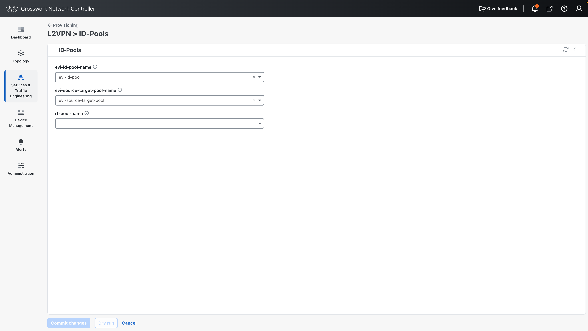
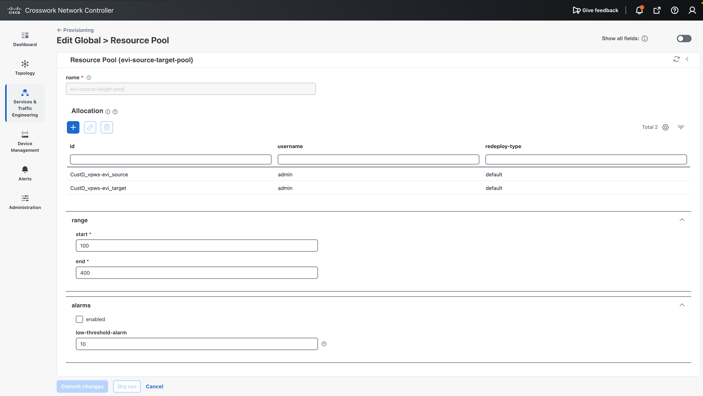
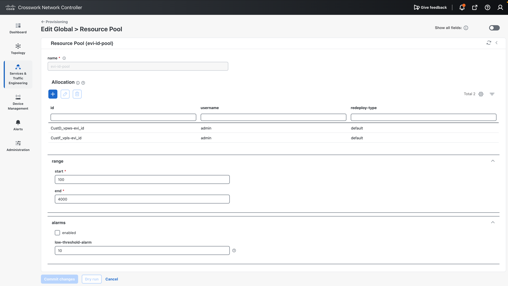

## 7.3 Create the VPWS service

1. Go to **Services & Traffic Engineering > Provisioning** and select **L2VPN-Service**.
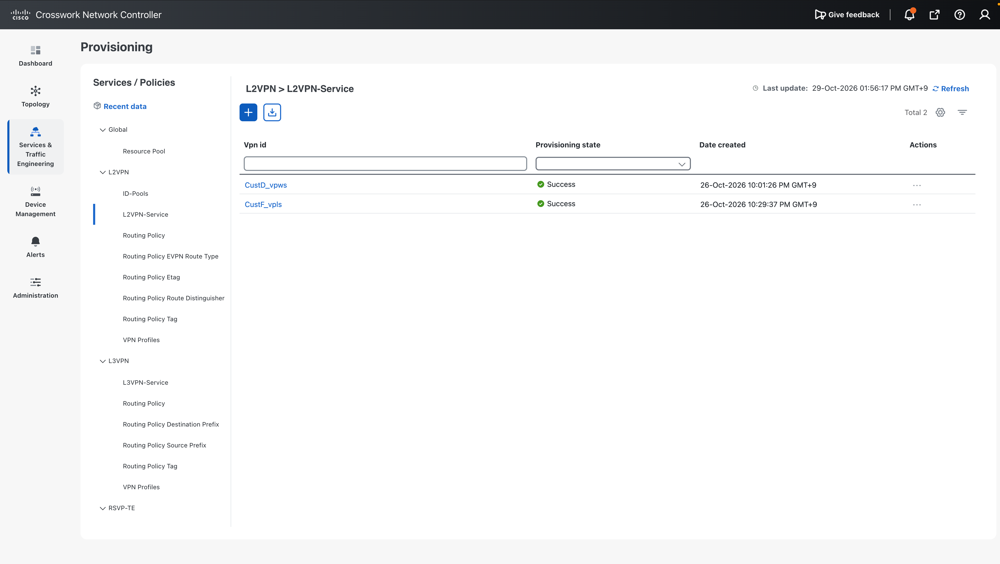
2. To save time, load the JSON file.
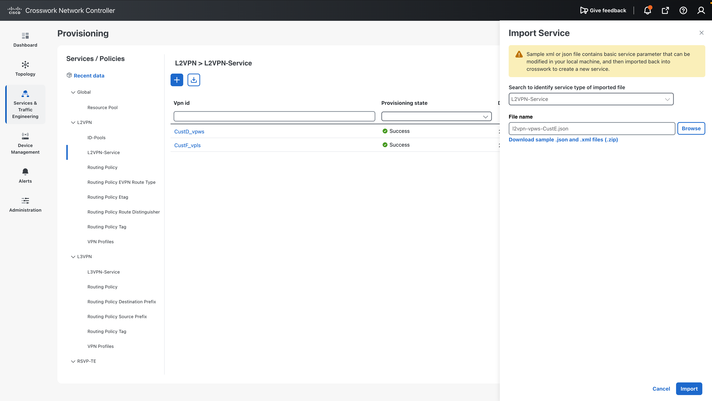

Payload: [l2vpn-vpws-CustE.json](../payloads/l2vpn-vpws-CustE.json)

<!-- SCREENSHOT: images/vpws-import.png | L2VPN-Service import dialog -->

## 7.4 Check the parameters

| Parameter                 | Value                                  | Notes                                              |
| ------------------------- | -------------------------------------- | -------------------------------------------------- |
| `vpn-id`                  | `CustE_vpws`                           |                                                    |
| `vpn-type`                | `vpws-evpn`                            |                                                    |
| EVI / source / target ID  | Auto assign                            | Unused values are taken from the pools. Fixed values are also possible |
| VPN nodes                 | PE1 (`FourHundredGigE0/0/0/2`, dot1q 300), PE3 (`FourHundredGigE0/0/0/3`, dot1q 200) | Tag pop 1, symmetric |
| SRv6                      | Locator `MAIN` on each node            |                                                    |
| Service assurance         | `Gold_L2VPN_ConfigProfile`             |                                                    |


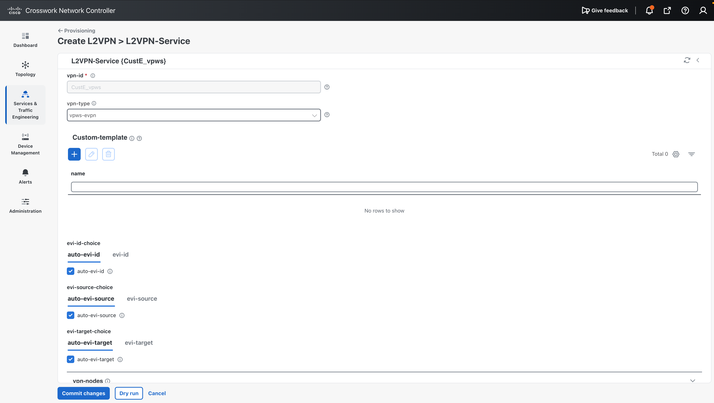
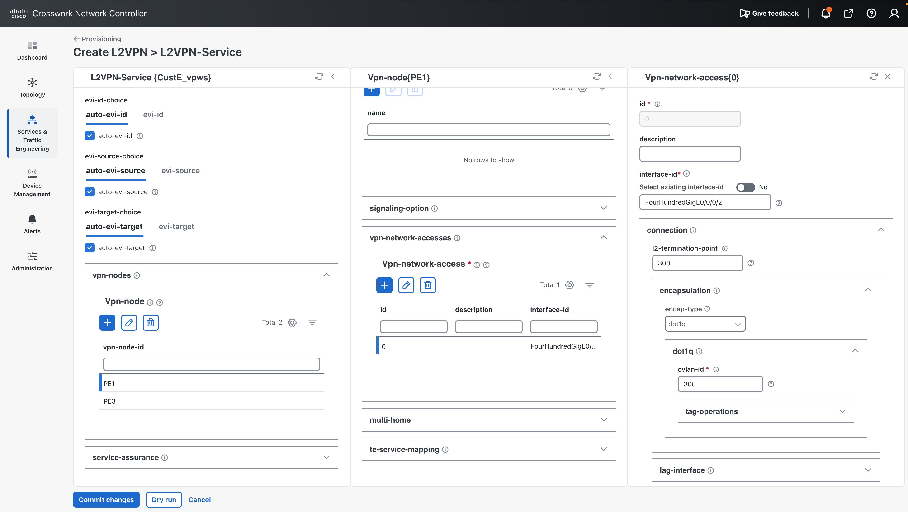
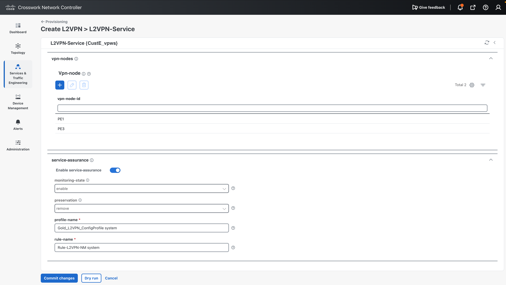

## 7.5 Dry run and commit

Run **Dry Run** to check the configuration that will be sent to the devices. If there are no problems, click **Commit**.

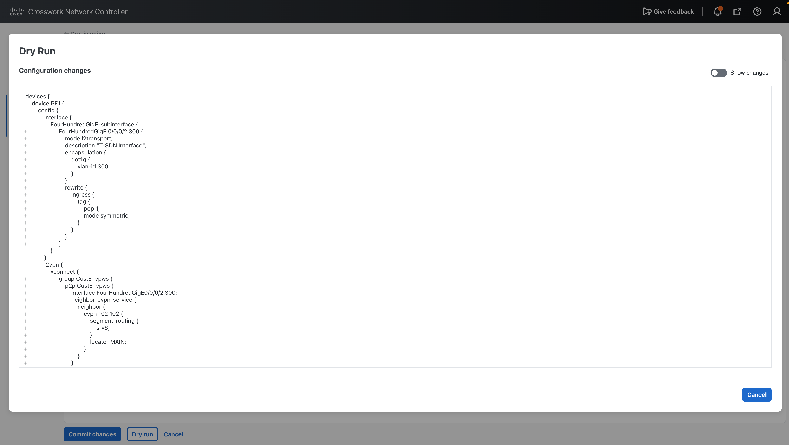
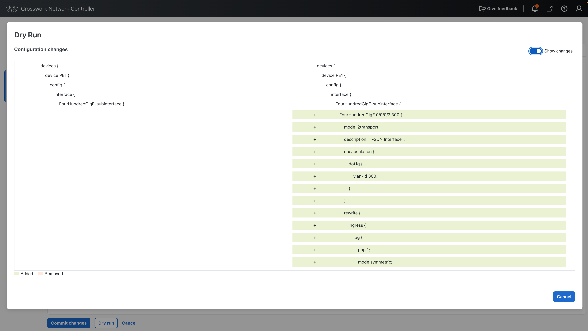

## 7.6 Verify

When the configuration is complete, the VPWS is shown as a point-to-point connection.

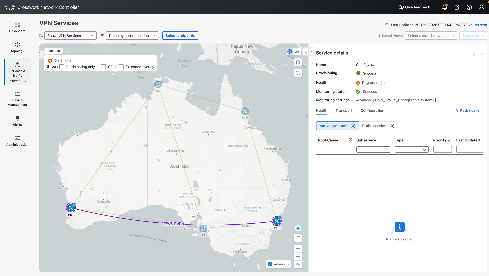

On PE1:

```text
RP/0/RP0/CPU0:PE1#show l2vpn xconnect 
Thu Oct 29 05:02:12.082 UTC
grLegend: ST = State, UP = Up, DN = Down, AD = Admin Down, UR = Unresolved,
        SB = Standby, SR = Standby Ready, (PP) = Partially Programmed,
        LU = Local Up, RU = Remote Up, CO = Connected, (SI) = Seamless Inactive

XConnect                   Segment 1                       Segment 2                
Group      Name       ST   Description            ST       Description            ST    
------------------------   -----------------------------   -----------------------------
CustD_vpws CustD_vpws UP   FH0/0/0/2.200          UP       EVPN 101,100,1         UP    
----------------------------------------------------------------------------------------
CustE_vpws CustE_vpws UP   FH0/0/0/2.300          UP       EVPN 102,102,2         UP    
----------------------------------------------------------------------------------------
RP/0/RP0/CPU0:PE1#show l2vpn xconnect group CustE_vpws detail
Thu Oct 29 05:02:23.770 UTC

Group CustE_vpws, XC CustE_vpws, state is up; Interworking none
Decoupled mode: Disabled
  AC: FourHundredGigE0/0/0/2.300, state is up
    Type VLAN; Num Ranges: 1
    Rewrite Tags: []
    VLAN ranges: [300, 300]
    MTU 1500; XC ID 0x4; interworking none; MSTi 7
    Statistics:
      packets: received 0, sent 0
      bytes: received 0, sent 0
      drops: illegal VLAN 0, illegal length 0
  EVPN: neighbor 2, PW ID: evi 102, ac-id 102, state is up ( established )
    XC ID 0xa0000003
    Encapsulation SRv6
    Encap type Ethernet
    Ignore MTU mismatch: Enabled
    Transmit MTU zero: Enabled
    Reachability: Up
    Force PW UP: Inactive
    Nexthop type: Service Group 2

      SRv6              Local                        Remote                      
      ----------------  ---------------------------- --------------------------
      uDX2              fcbb:bb00:1:e008::           fcbb:bb00:3:e005::
      AC ID             102                          102                         
      MTU               1514                         0                           
      Locator           MAIN                         N/A                         
      Locator Resolved  Yes                          N/A                         
      SRv6 Headend      H.Encaps.L2.Red              N/A                         
    Statistics:
      packets: received 0, sent 0
      bytes: received 0, sent 0
RP/0/RP0/CPU0:PE1#
```

## Next step

Go to [08. L2VPN VPLS Provisioning](../08-l2vpn-vpls/index.md).
