# 08. L2VPN VPLS Provisioning

!!! abstract "Goal"

      Create an SRv6 EVPN ELAN (VPLS) from CNC with multi-homing, and steer its traffic with an ODN policy.

## 8.1 About ODN

On-Demand Next-hop (ODN) is an SR policy template that has a color but no end-point.
A policy is instantiated when the head-end receives a route with that color.

Two ODN templates are configured on all PEs:


| Color | Purpose                                  | Payload                                                                         |
| ----- | ---------------------------------------- | ------------------------------------------------------------------------------- |
| 30    | Exclude links with affinity `RED`        | [odn_policy_color30.json](../payloads/preconfiguration/odn_policy_color30.json) |
| 40    | Optimize on the TE metric (PCE-computed) | [odn_policy_color40.json](../payloads/preconfiguration/odn_policy_color40.json) |


```text
RP/0/RP0/CPU0:PE1#show run segment-routing traffic-eng on-demand color 30   
Thu Oct 29 05:27:03.705 UTC
segment-routing
 traffic-eng
  on-demand color 30
   srv6
    locator MAIN binding-sid dynamic behavior ub6-insert-reduced
   !
   dynamic
    pcep
    !
    metric
     type igp
    !
    affinity
     exclude-any
      name RED
     !
    !
   !
  !
 !
!

RP/0/RP0/CPU0:PE1#show run segment-routing traffic-eng on-demand color 40
Thu Oct 29 05:27:07.372 UTC
segment-routing
 traffic-eng
  on-demand color 40
   srv6
    locator MAIN binding-sid dynamic behavior ub6-insert-reduced
   !
   dynamic
    pcep
    !
    metric
     type te
    !
   !
  !
 !
!

RP/0/RP0/CPU0:PE1#
```

The new VPN uses the color 40 ODN policy. As with the L3VPN, the route policy tag and routing policy are created in advance:


| Object           | Name       | Payload                                                                                                 |
| ---------------- | ---------- | ------------------------------------------------------------------------------------------------------- |
| Route policy tag | `COLOR_40` | [l2vpn-route-policy-tag_Color40.json](../payloads/preconfiguration/l2vpn-route-policy-tag_Color40.json) |
| Routing policy   | `POLICY4`  | [l2vpn-route-policy_Policy4.json](../payloads/preconfiguration/l2vpn-route-policy_Policy4.json)         |


## 8.2 Create the VPLS service

1. Go to **Services & Traffic Engineering > Provisioning** and select **L2VPN-Service**.
2. Add CustomerG's VPLS by loading the JSON file.

Payload: [l2vpn-vpls-odn_CustG.json](../payloads/l2vpn-vpls-odn_CustG.json)

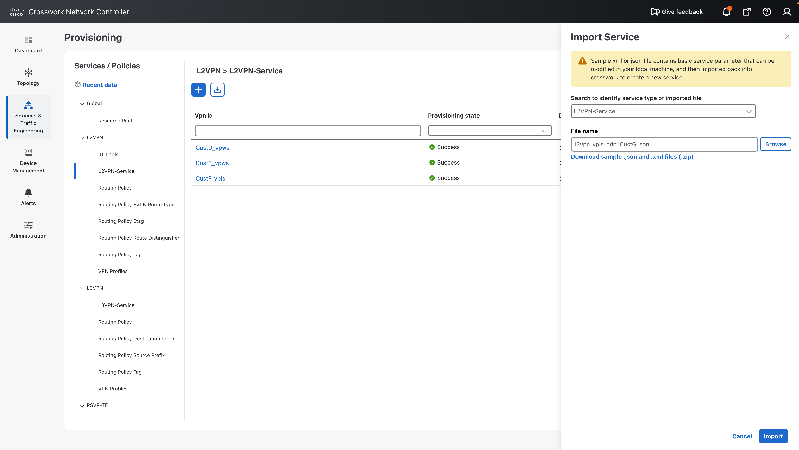

## 8.3 Check the parameters


| Parameter              | Value                                                              | Notes                                 |
| ---------------------- | ------------------------------------------------------------------ | ------------------------------------- |
| `vpn-id`               | `CustG_vpls`                                                       |                                       |
| `vpn-type`             | `mpls-evpn`                                                        | Also used for SRv6                    |
| `vpn-service-topology` | `any-to-any`                                                       |                                       |
| EVI                    | Auto assign                                                        |                                       |
| Bridge group           | `BRIDGE`                                                           |                                       |
| MAC learning mode      | Control plane (each node)                                          | MAC addresses are learned over MP-BGP |
| Access interfaces      | PE1 `FourHundredGigE0/0/0/2`, PE2 / PE3 `Bundle-Ether1`, dot1q 501 | Tag pop 1, symmetric                  |
| TE service mapping     | SRv6 locator `MAIN`, ODN with `POLICY4`                            | `POLICY4` sets color 40               |
| Multi-homing           | PE2 and PE3, ESI `23.23.00.00.00.00.00.00.00`                      | Same ESI on both PEs                  |


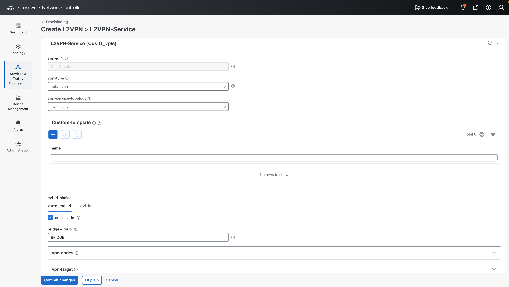
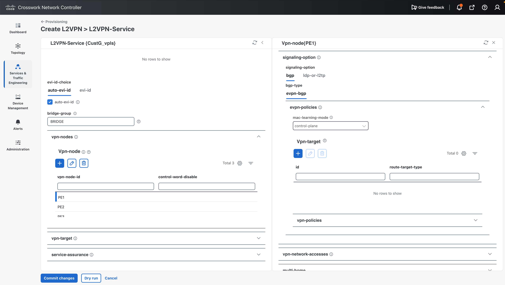
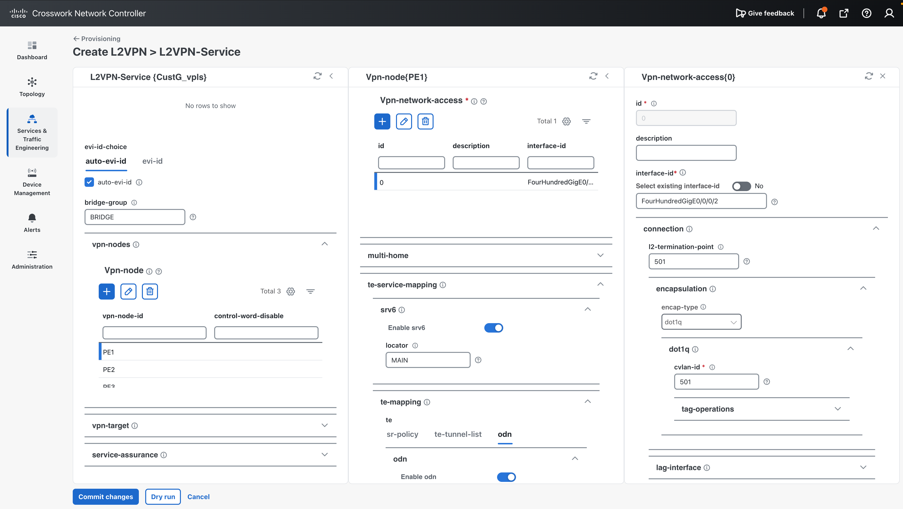
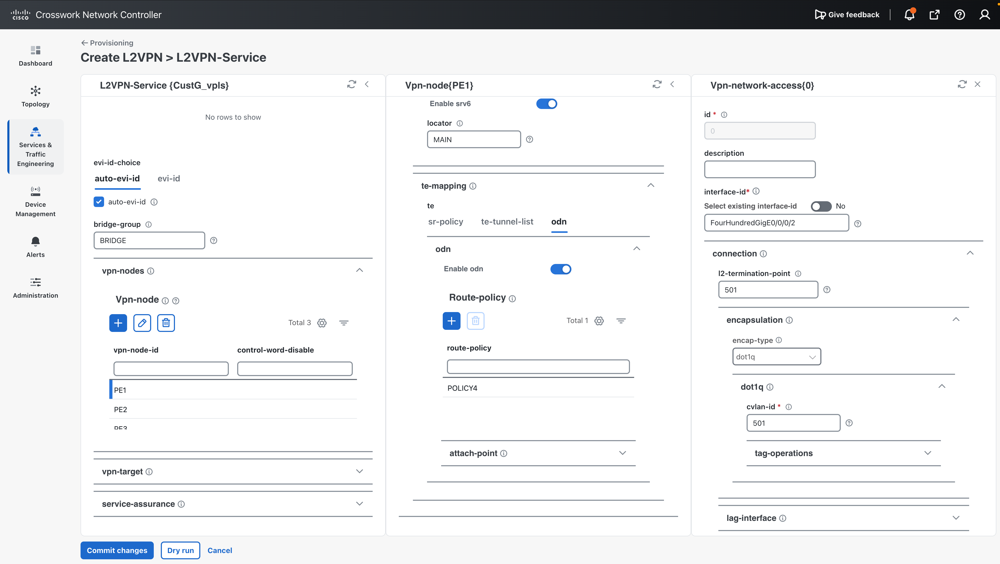

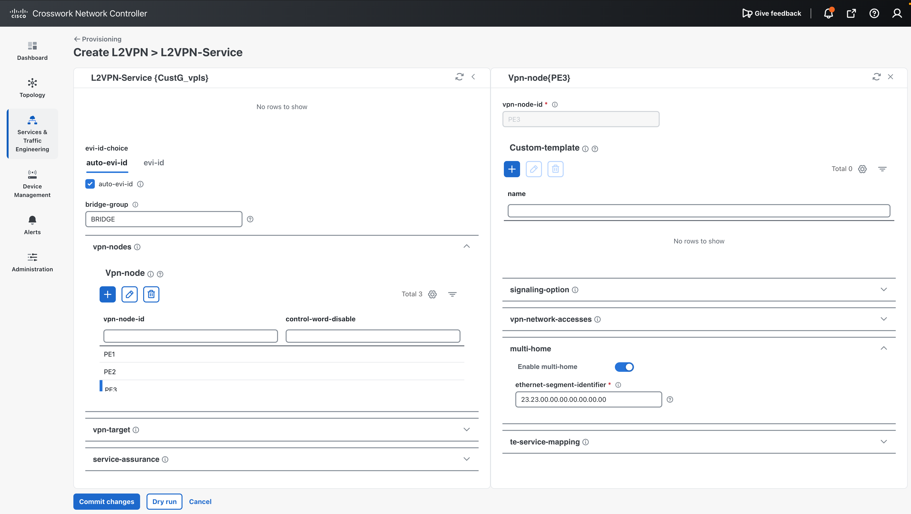

!!! tip "SRv6 ELAN needs ODN with the default VPLS template"

      With the CLI NED, the `segment-routing srv6` keyword under `evpn evi` is only generated together with the ODN route policy.
      Without ODN, the EVI is created as an MPLS EVI and the commit is rejected with
      "This EVPN instance id is already in use with other EVPN services".


## 8.4 Dry run and commit

Run **Dry Run**. If there are no problems, click **Commit** to push the configuration through NSO.

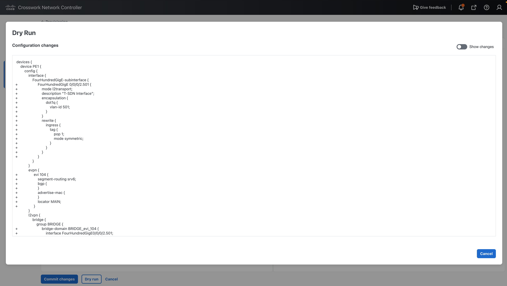
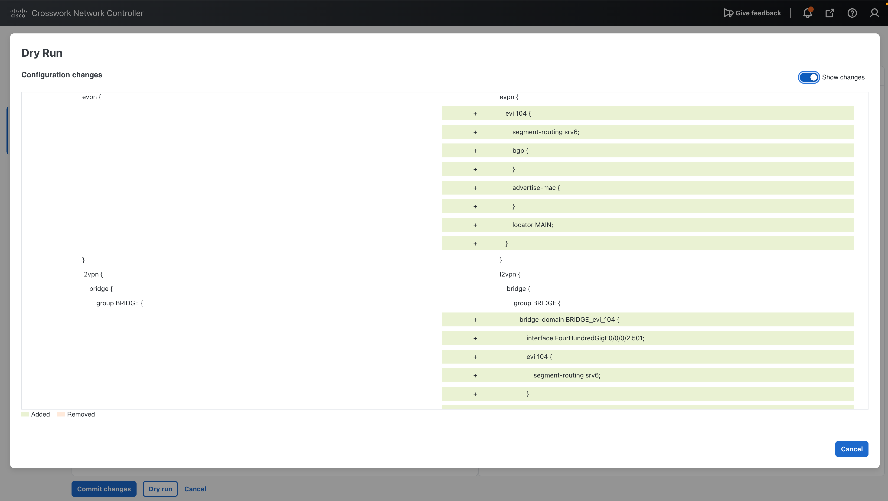

## 8.5 Device configuration outside the service

These items are not part of the L2VPN service model in this version, so they are configured on the PEs in advance
(manually, or with a [configuration template](../09-config-template/index.md)):

```text
evpn
 segment-routing srv6
  locator MAIN
 !
!
router bgp 65000
 neighbor-group PEs
  address-family l2vpn evpn
   route-policy POLICY4 out
  !
 !
!
```

- The global EVPN SRv6 locator is needed for the EVI to get its SRv6 SIDs (uDT2U / uDT2M).
- The `route-policy POLICY4 out` on the neighbor group sets color 40 on the EVPN routes sent to the other PEs.

Go to **Device Management > Network Devices** and select `PE1`, `PE2` and `PE3`. Then **Sync-from device to NSO** in Actions.
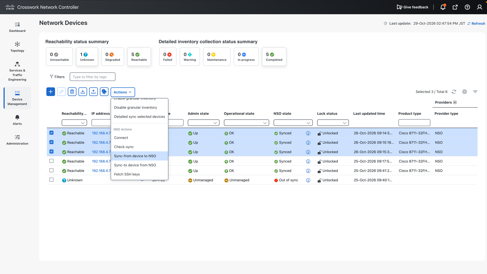

## 8.6 Verify

The VPLS is shown as a multipoint connection, with the ODN policies in a full mesh.

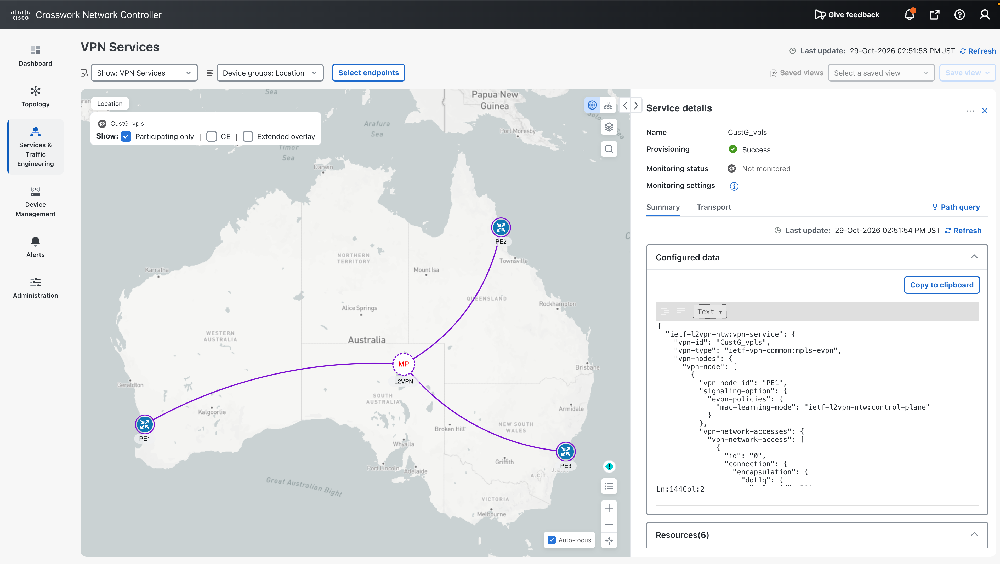
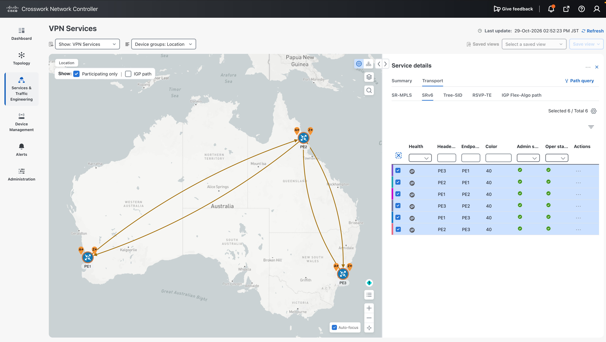

On PE3:

```text
RP/0/RP0/CPU0:PE3#show evpn evi vpn-id 104 detail
Thu Oct 29 05:53:37.806 UTC

VPN-ID     Encap      Bridge Domain                Type               
---------- ---------- ---------------------------- -------------------
104        SRv6       BRIDGE_evi_104               EVPN               
   Stitching: Regular
   Unicast SID:  fcbb:bb00:3:e008::                     
   Multicast SID:  fcbb:bb00:3:e009::                     
   E-Tree: Root
   Forward-class: 0
   Advertise MACs: Yes
   Advertise BVI MACs: No
   Aliasing: Enabled
   UUF: Enabled
   Re-origination: Enabled
   Multicast:
     IGMP-Snooping Proxy: No
     MLD-Snooping Proxy : No
   BGP Implicit Import: Enabled
   VRF Name: 
   SRv6 Locator Name: MAIN
   SRv6 SID Function Length: 16 bits
   Preferred Nexthop Mode: Off
   BVI Coupled Mode: No
   BVI Subnet Withheld: ipv4 No, ipv6 No
   L3VRF Label Mode: Per-VRF
   RD Config: none
   RD Auto  : (auto) 3.3.3.3:104
   RT Auto  : 65000:104
   Route Targets in Use           Type                 
   ------------------------------ ---------------------
   65000:104                      Import               
   65000:104                      Export               

RP/0/RP0/CPU0:PE3#
RP/0/RP0/CPU0:PE3#show evpn ethernet-segment esi 0023.2300.0000.0000.0000 detail 
Thu Oct 29 05:55:04.405 UTC
Legend:
  B   - No Forwarders EVPN-enabled,
  C   - MAC missing (Grouping ES-MAC vES),
  RT  - ES-Import Route Target missing,
  E   - ESI missing,
  H   - Interface handle missing,
  I   - Name (Interface or Virtual Access) missing,
  M   - Interface in Down state,
  O   - BGP End of Download missing,
  P   - Interface already Access Protected,
  Pf  - Interface forced single-homed,
  R   - BGP RID not received,
  S   - Interface in redundancy standby state,
  X   - ESI-extracted MAC Conflict
  SHG - No local split-horizon-group label allocated
  Hp  - Interface blocked on peering complete during HA event
  Rc  - Recovery timer running during peering sequence

Ethernet Segment Id      Interface                          Originating IP      
------------------------ ---------------------------------- --------------------
0023.2300.0000.0000.0000 BE1                                2.2.2.2
                                                            3.3.3.3
  ES to BGP Gates   : Ready
  ES to L2FIB Gates : Ready
  Main port         :
     Interface name : Bundle-Ether1
     Interface MAC  : 00a0.b304.8104
     IfHandle       : 0x7800001c
     State          : Up
     Redundancy     : Not Defined
  ESI ID            : 1
  ESI type          : 0
     Value          : 0023.2300.0000.0000.0000
  ES Import RT      : 2323.0000.0000 (from ESI)
  Topology          :
     Operational    : MH, All-active
     Configured     : All-active (AApF) (default)
  Service Carving   : Auto-selection
     Multicast      : Disabled
  Convergence       : 
  Peering Details   : 2 Nexthops
     2.2.2.2 [MOD:P:00:T]
     3.3.3.3 [MOD:P:00:T]
  Service Carving Synchronization:
     Mode           : NONE
     Peer Updates   :
                 2.2.2.2 [SCT: N/A]
                 3.3.3.3 [SCT: N/A]
  Service Carving Results:
     Forwarders     : 2
     Elected        : 1
     Not Elected    : 1
  EVPN-VPWS Service Carving Results:
     Primary        : 0
     Backup         : 0
     Non-DF         : 0
  MAC Flush msg     : STP-TCN
  Peering timer     : 3 sec [not running]
  Recovery timer    : 30 sec [not running]
  Carving timer     : 0 sec [not running]
  Revert timer      : 0 sec [not running]
  HRW Reset timer   : 5 sec [not running]
  Local SHG filters :
      (mpls)                None
      (srv6)                1:16
  Remote SHG filters: 1
      (srv6)                1:16 : nexthop fcbb:bb00:2::1
  Access signal mode: Bundle OOS

RP/0/RP0/CPU0:PE3#
RP/0/RP0/CPU0:PE3#show segment-routing traffic-eng policy color 40 tabular 
Thu Oct 29 05:55:56.809 UTC

'd': Dropping traffic

 Color                                Endpoint  Admin   Oper                 Binding
                                                State  State                     SID
------ --------------------------------------- ------ ------ -----------------------
    40                          fcbb:bb00:1::1     up     up      fcbb:bb00:3:e00c::
    40                          fcbb:bb00:2::1     up     up      fcbb:bb00:3:e00d::
RP/0/RP0/CPU0:PE3#
```


## Next step

Go to [09. Configuration Templates](../09-config-template/index.md).

!!! Note

      To delete the VPLS service, please be sure to **delete** the following configuration and **sync-from** before.
      ```text
         router bgp 65000
         neighbor-group PEs
         address-family l2vpn evpn
            no route-policy POLICY4 out
            !
           !
         !
      ```

