# 09. Configuration Templates

!!! abstract "Goal"

    Deploy configuration to devices with a configuration template, and run show commands on several devices at once.

## 9.1 About configuration templates

Go to **Device Management > Configuration Template**.
Configuration templates apply configuration to network devices quickly and consistently, for example for underlay or interface configuration.
Predefined templates are provided, and you can also create your own.

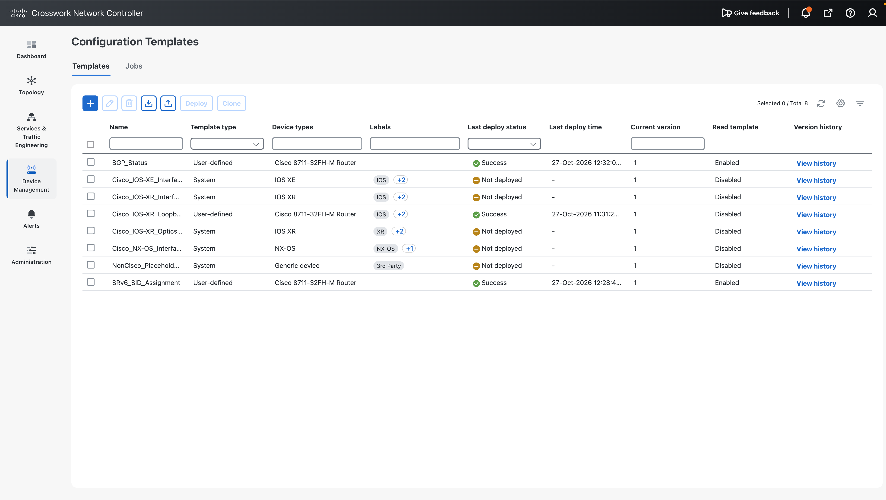

## 9.2 Template contents

As an example, look at a template that configures a loopback interface.

1. **General**: the template name and the target device type. `8711` is selected here.
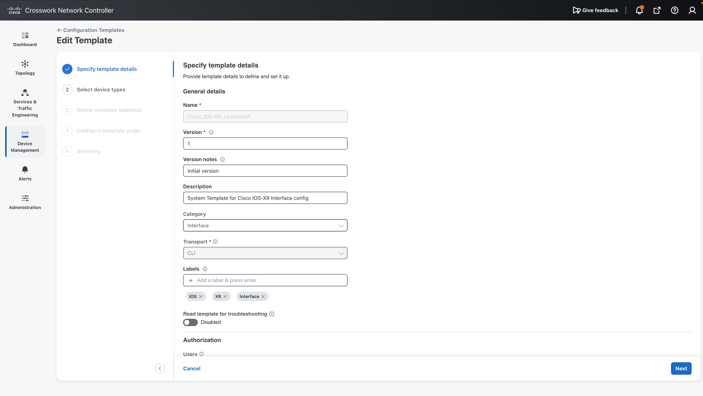
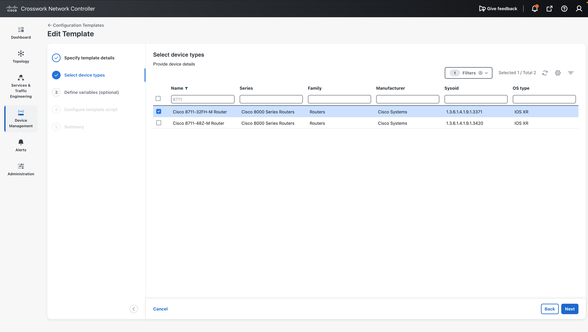
2. **Parameters**: the loopback number, the description, and the admin state.
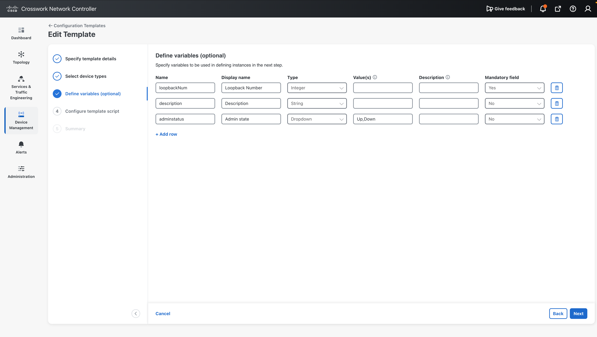
3. **Template script**: written in Apache Velocity Template Language (VTL).
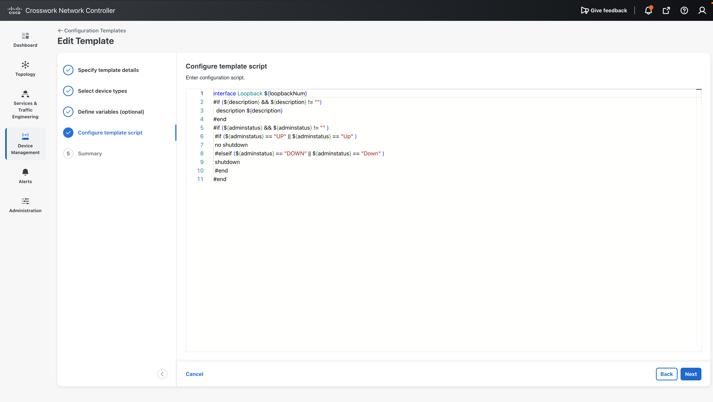

## 9.3 Deploy the template

1. Select the template and click **Deploy**.
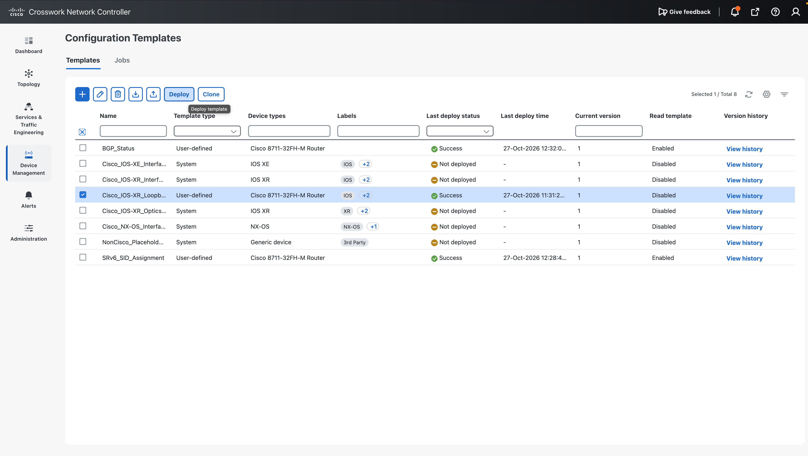
2. Select the target device: **P5**.
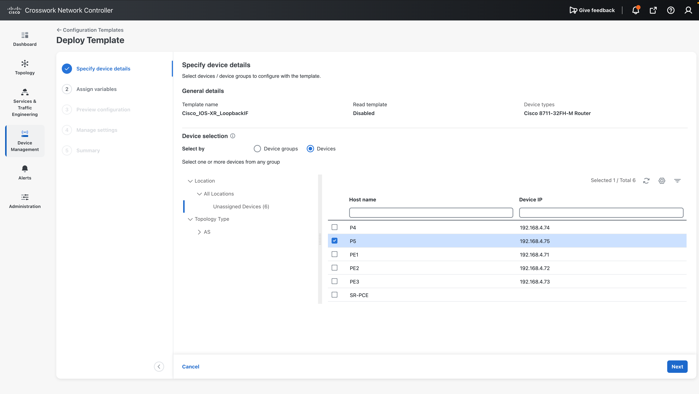
3. Fill in the variables: `Loopback101`, description `from Config Template`.
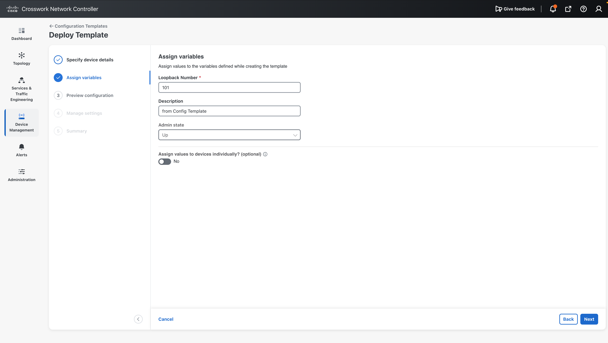
4. Check the configuration and set the deploy timing to **Now**.
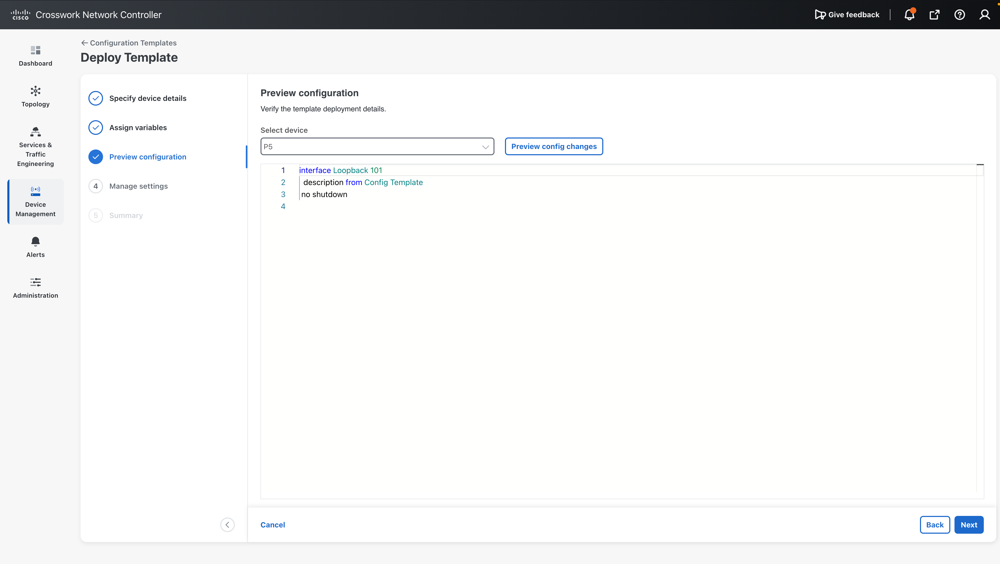
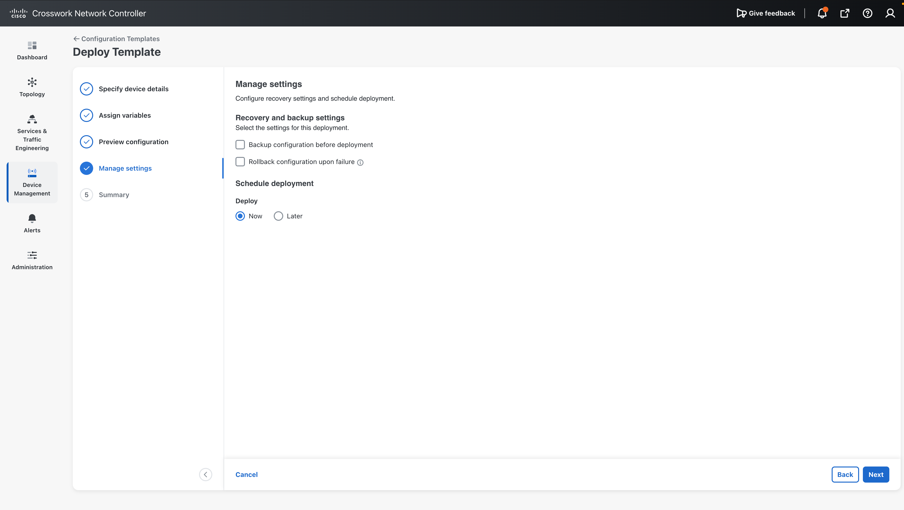
   Scheduling is also possible, for example to run during a night maintenance window.
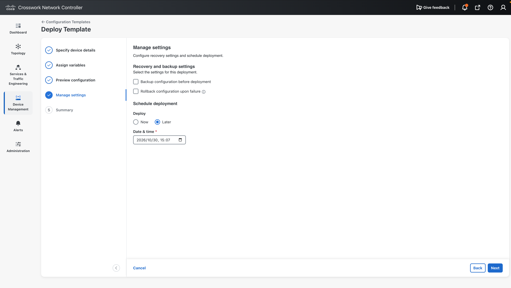
5. Click **Deploy Template**.
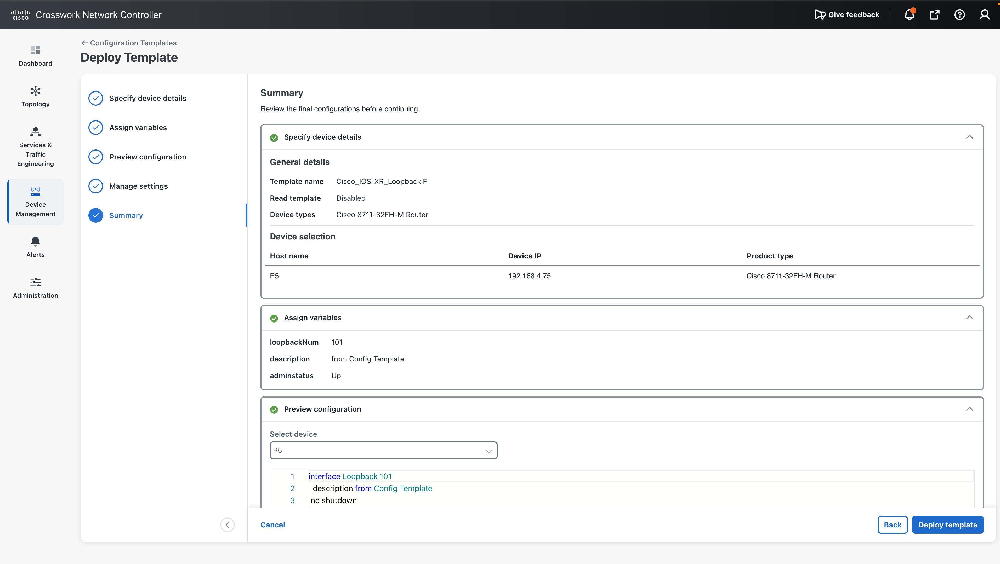

## 9.4 Check the job

Check the progress in **Jobs**. When the job succeeds, open **View Results** to see the logs.

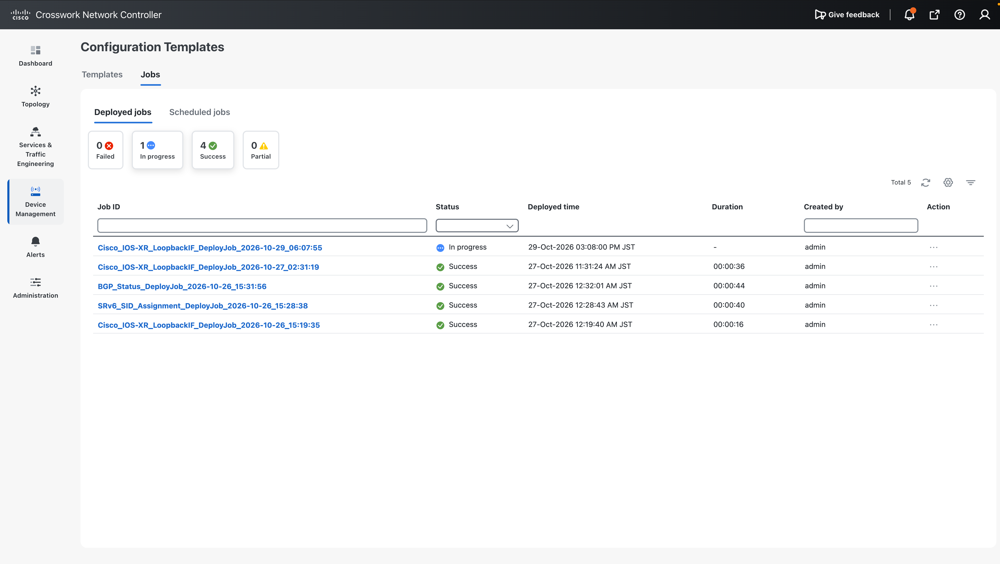
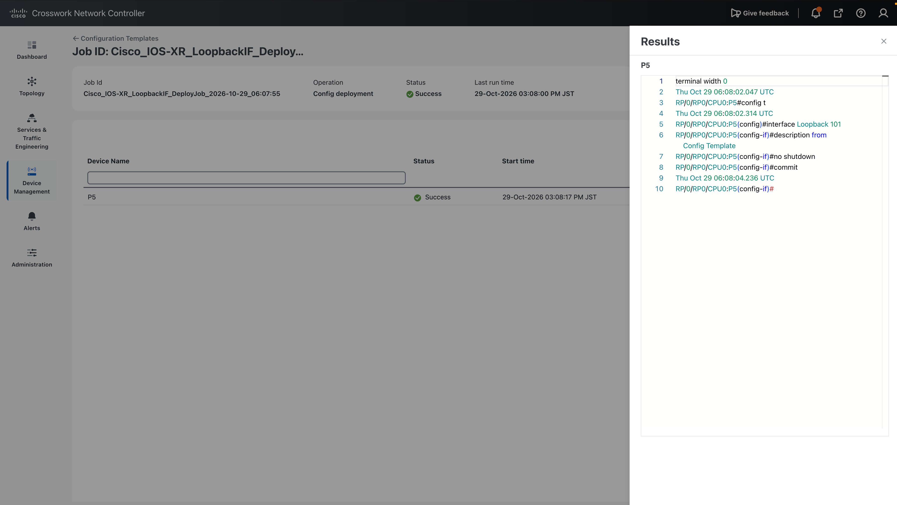

On P5:

```text
RP/0/RP0/CPU0:P5#show running-config interface Loopback101
Thu Oct 29 06:09:43.514 UTC
interface Loopback101
 description from Config Template
!
```

## 9.5 Run show commands with a template

Configuration templates can also collect show command output.
Enable **Read template for troubleshooting**, select the target devices, and write the show commands in the template.
When you run it, the same show commands run on several devices at once and you can check the results.

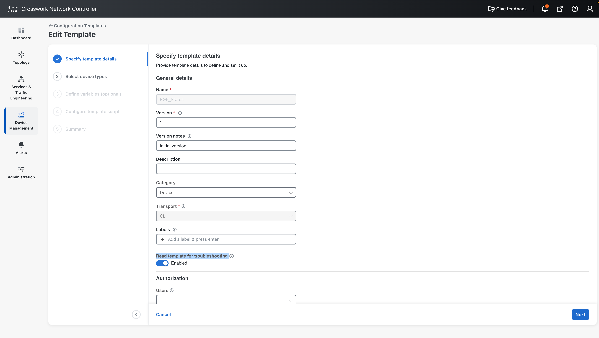
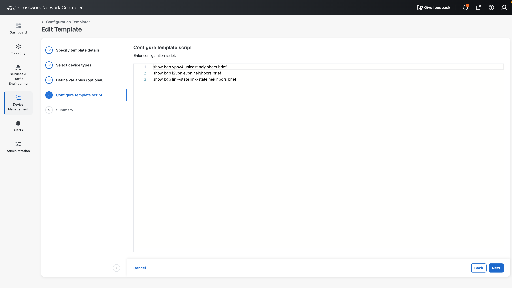
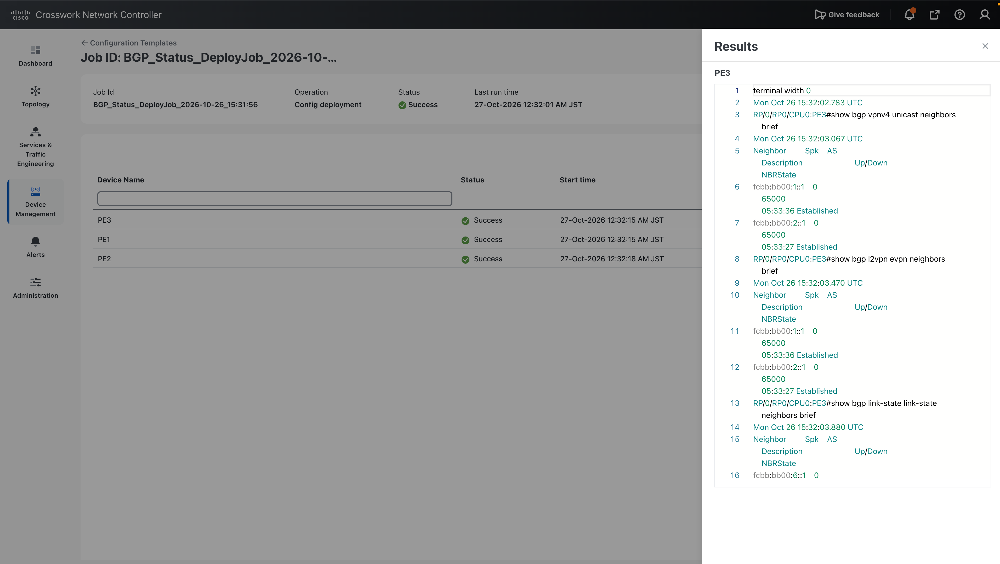

## Next step

Go to [10. Configuration Backup and Restore](../10-backup-restore/index.md).
