# 10. Configuration Backup and Restore

!!! abstract "Goal"

    Back up device configuration, compare it with earlier versions, and restore it.

## 10.1 Schedule a backup

1. Go to **Device Management > Configuration Backup & Restore**.
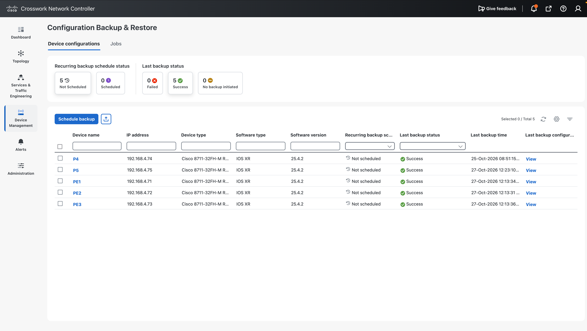
2. Click **Schedule backup** and select the target device.
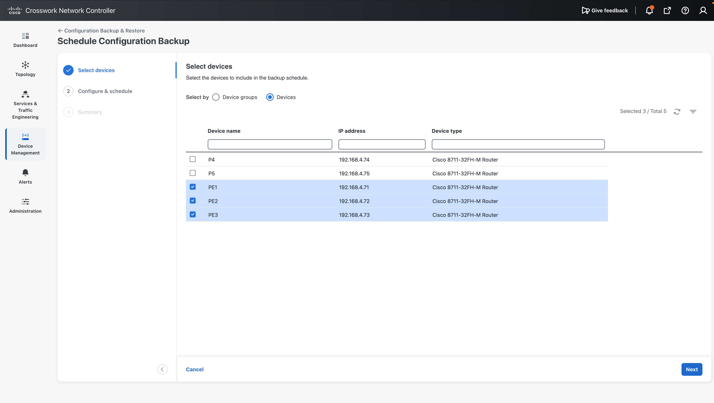
3. Set the backup name and the timing. Backups can run periodically or immediately.
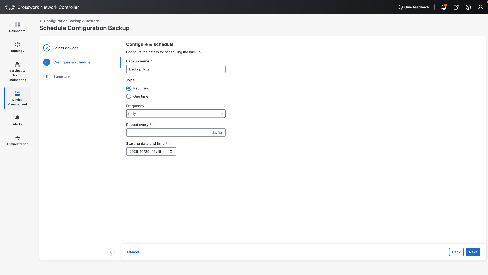
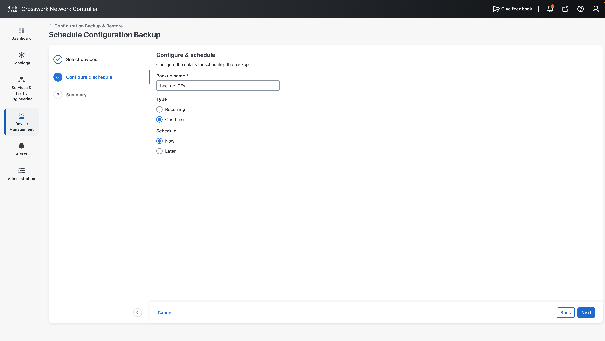
4. Click **Schedule Backup**.
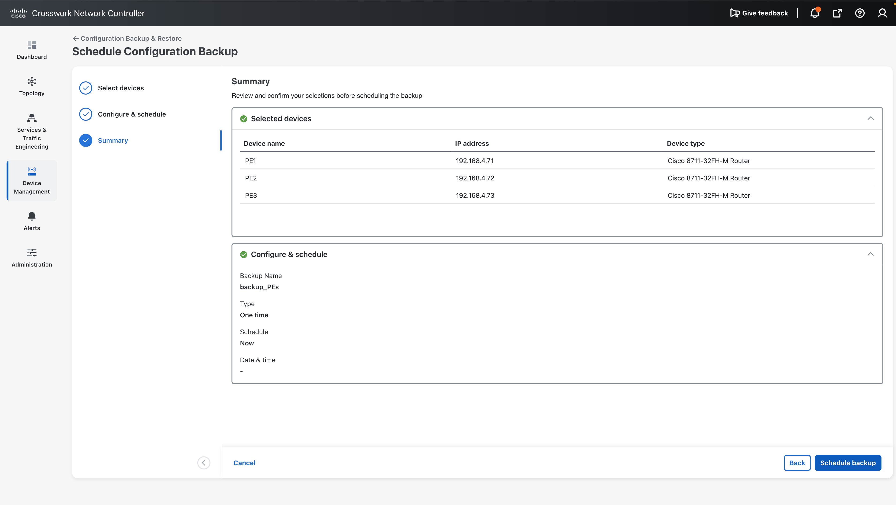

## 10.2 View and compare backups

- To view a backup, select the job name, select the run ID, and click the device name.
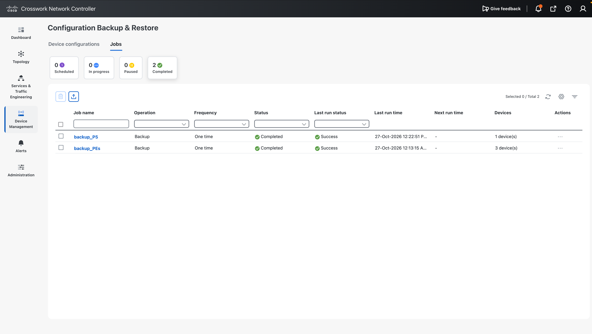
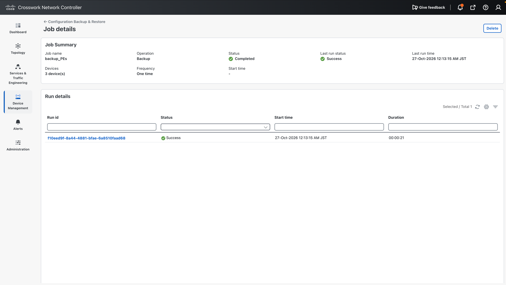
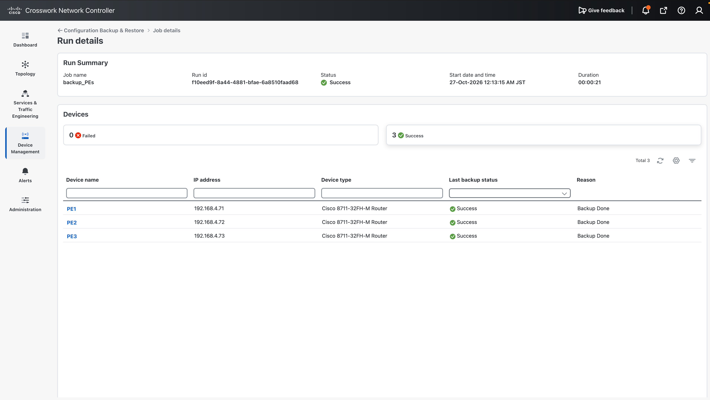
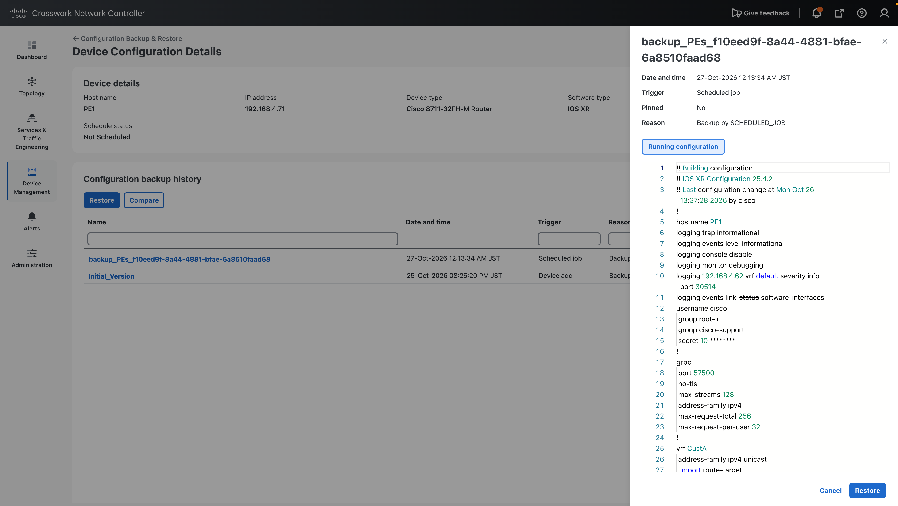
- To compare with an earlier configuration, click the device name and click **Compare**.
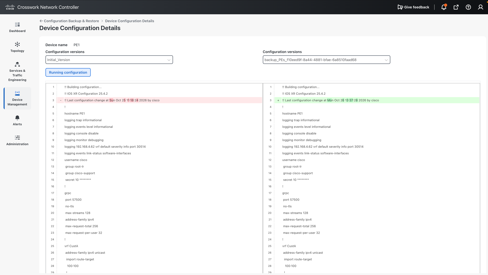
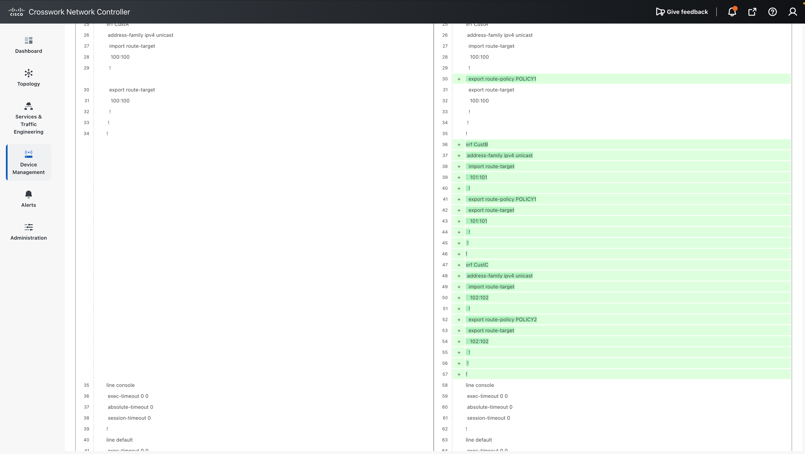

## 10.3 Restore

1. Click **Restore** and select the backup file.
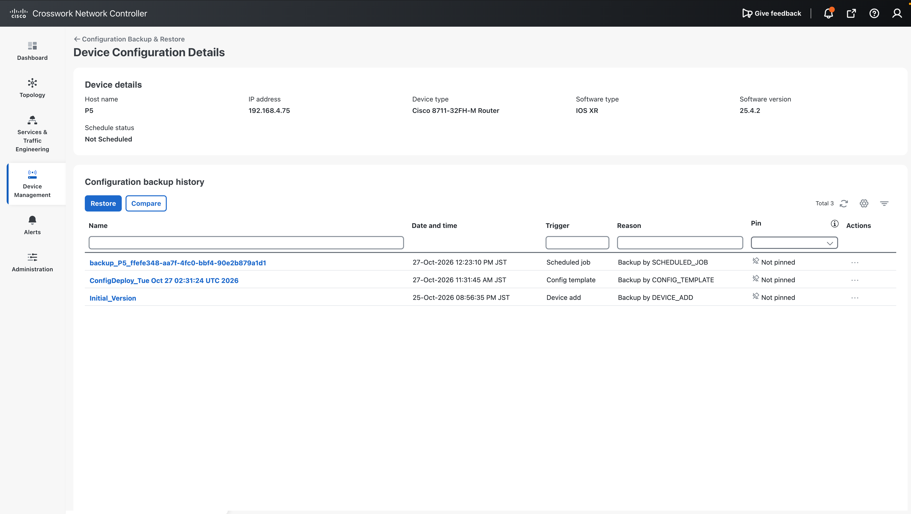
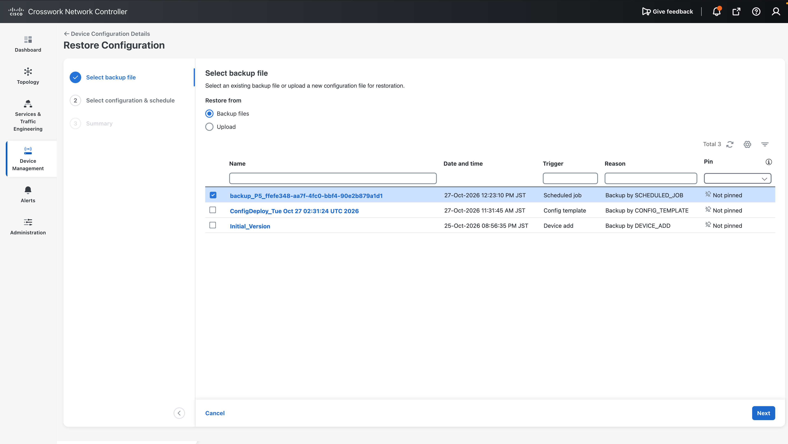

2. Specify the restore target and the schedule.
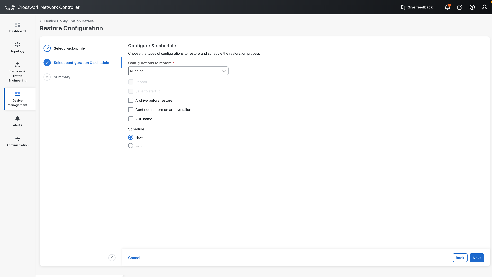

3. Click **Restore** to start.
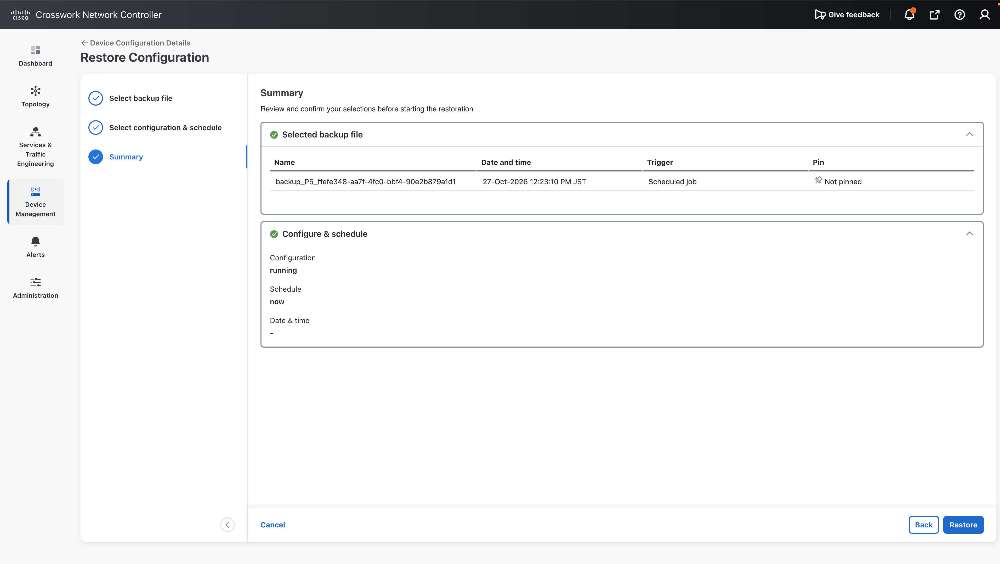
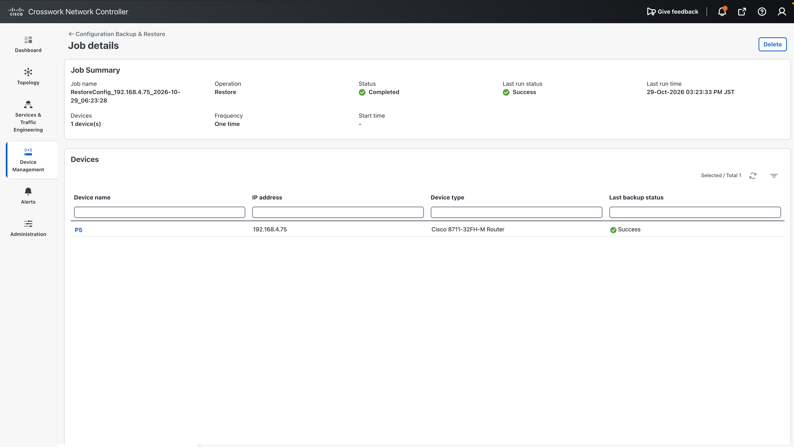

This is the end of the demo.
